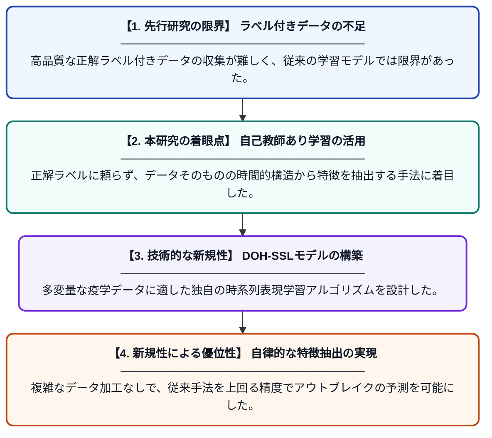

# フィリピン保健省の監視データを用いた自己教師あり時系列表現学習による感染症流行予測

**Original Title**: *Self-Supervised Temporal Representation Learning for Infectious Disease Outbreak Prediction Using Philippine DOH Surveillance Data*

> **💡 一言要約**: AIが自律学習し、感染症の流行を予測する

| 項目 | 内容 |
|---|---|
| **著者** | MY Orong, J Matias, ES Ybanez, CZ Cabatingan |
| **掲載誌** | International Conference on … 2026 |
| **アラートキーワード** | representation learning |
| **原文リンク** | [https://ieeexplore.ieee.org/abstract/document/11736797/](https://ieeexplore.ieee.org/abstract/document/11736797/) |
| **PDF版要約** | [README.pdf](./README.pdf) |

---

## 📊 新規性の図解（先行研究との違いと本研究のブレークスルー）

## 📝 要約

本研究は、フィリピン保健省の多変量疫学データを解析するために、DOH-SSLと呼ばれる自己教師あり時系列表現学習アプローチを提案しました。このモデルは生の時系列データから有益な特徴を自律的に学習し、感染症のアウトブレイク予測精度を向上させます。

## ❓ どんな問題に取り組んだか

従来の感染症予測手法は、ラベル付きデータの不足や、複雑な多変量時系列データの依存関係を十分に捉えられないという課題がありました。また、膨大な監視データから予測に有用な情報を効率的に抽出する汎用的な手法も不足していました。

## ✨ 何が新しい？何がすごい？（新規性）

本研究の新規性は、自己教師あり学習（Self-Supervised Learning）を多変量疫学データに特化させた「DOH-SSL」を開発した点にあります。ラベルのない生の監視データから時間的な相関関係を直接学習することで、手動の特徴量エンジニアリングを排除しました。フィリピン保健省の実データを用いて、限られた情報下でも高度な表現獲得が可能であることを示した点が大きな貢献です。

## 🎓 大学1年生向けの解説

この研究は、AIを使って「いつ感染症が流行するか」をより正確に当てるための新しい方法を開発したものです。通常、AIの学習には人間が答えを教える必要がありますが、この方法はデータの中からAIが自分でルールを見つけ出す仕組み（自己教師あり学習）を使っています。フィリピンの実際の保健データを使って、難しい準備なしに流行の兆しを掴めるようにしたのがすごいところです。
