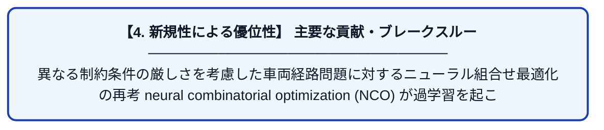

# Rethinking Neural Combinatorial Optimization for Vehicle Routing Problems with Different Constraint Tightness Degrees

| 項目 | 内容 |
|---|---|
| **PDF版要約** | [README.pdf](./README.pdf) |

---

## 📊 新規性の図解（先行研究との違いと本研究のブレークスルー）

## 📝 要約

異なる制約条件の厳しさを考慮した車両経路問題に対するニューラル組合せ最適化の再考

neural combinatorial optimization (NCO)

が過学習を起こしたり、パフォーマンスが低下する原因を、

同一の問題設定の異なる制約条件に対して、色々実験を行い、分析をした論文。

キーワード :

POMO : Policy optimization with multiple optima for reinforcement learning

BQ : BQ-NCO: Bisimulation quotienting for efficient neural combinatorial optimization.

LEHD :

INViT :

MVMoE :

MDAM :

POMO-MTL :
