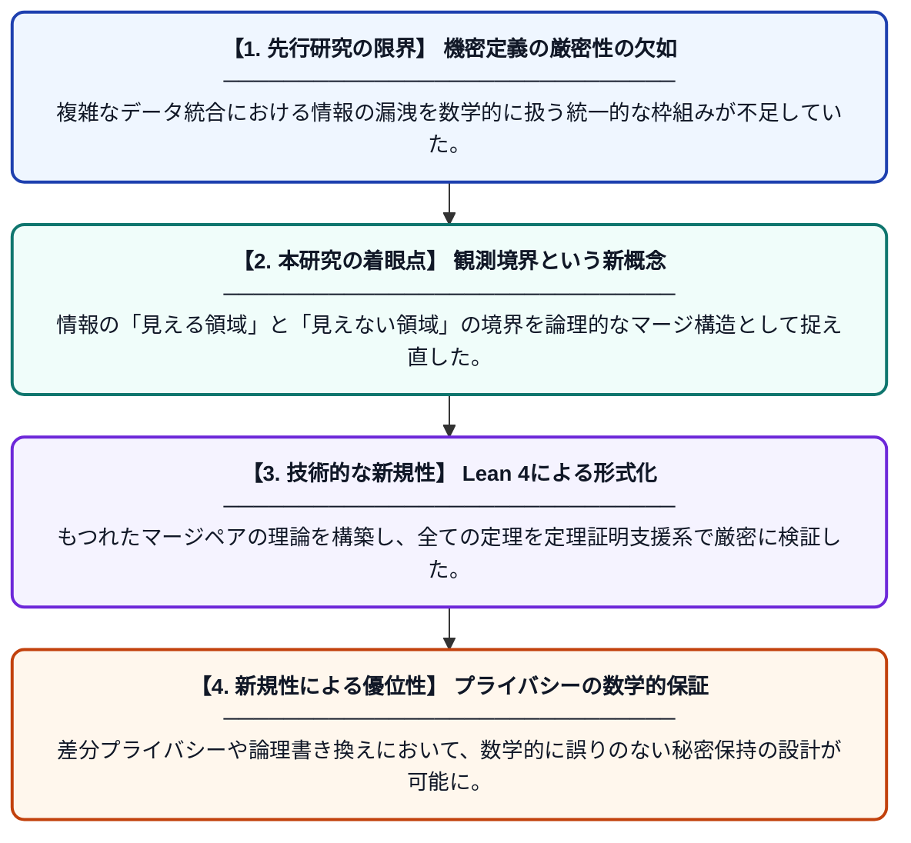

# もつれたマージペア：観測境界原理

**Original Title**: *Entangled Merged Pairs: The Observation-Boundary Principle*

> **💡 一言要約**: 情報の境界とプライバシーを数理的に定義する

| 項目 | 内容 |
|---|---|
| **著者** | M Rahnama |
| **掲載誌** | 2026 |
| **アラートキーワード** | differential privacy |
| **原文リンク** | [https://hal.science/hal-05838140/](https://hal.science/hal-05838140/) |
| **PDF版要約** | [README.pdf](./README.pdf) |

---

## 📊 新規性の図解（先行研究との違いと本研究のブレークスルー）

## 📝 要約

機密性や差分プライバシーを数理的に扱うための新しい枠組み「観測境界原理」を提案する研究です。情報のマージと観測の境界を論理的に定義し、その正当性を定理証明支援系Lean 4を用いて厳密に証明しています。

## ❓ どんな問題に取り組んだか

情報の機密保持や差分プライバシーにおいて、データの統合や境界での情報の振る舞いを数学的に一貫して記述する手法が不足していました。特に、複雑な論理体系や書き換えシステムにおいて、プライバシー保護の性質を厳密に保証することが困難でした。

## ✨ 何が新しい？何がすごい？（新規性）

「もつれたマージペア」という新概念を導入し、情報の観測可能性とその境界を統一的に扱う「観測境界原理」を確立した点が画期的です。従来の差分プライバシーの議論を抽象的な論理構造へと昇華させ、書き換え体系への応用を可能にしました。また、主要な定理をLean 4で形式化することで、理論の絶対的な正確性を担保しています。

## 🎓 大学1年生向けの解説

インターネットでデータをやり取りする際、どこまでが秘密でどこからが見えていいのかという「境界線」を数学で定義する研究です。データが混ざり合ったときに秘密が漏れないようにするルールを、パズルのような論理学の仕組みで作りました。このルールが絶対に正しいことを、コンピュータ（Lean 4）を使って完璧にチェックしているのがすごいところです。
