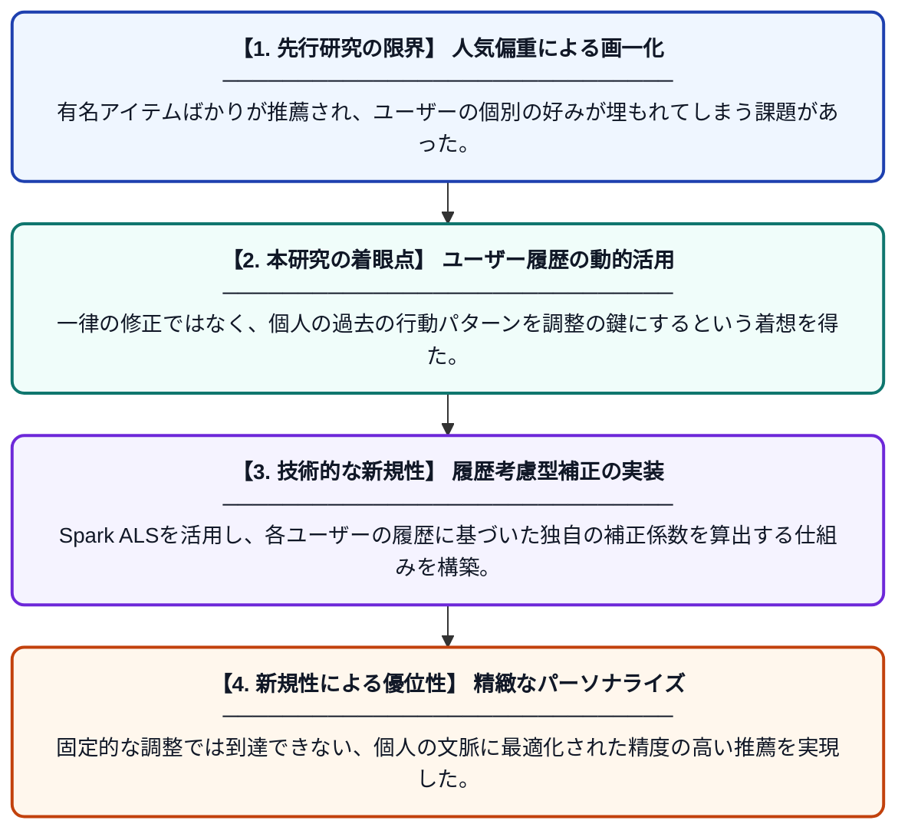

# レコメンダーシステムにおける履歴を考慮した人気度キャリブレーション

**Original Title**: *1302-GC History-Aware Popularity Calibration in Recommender Systems*

> **💡 一言要約**: 履歴活用で「人気への偏り」を正す次世代の推薦技術

| 項目 | 内容 |
|---|---|
| **著者** | G Devaraj, D Shy, M Juttiga, T Witte, J Rainford |
| **掲載誌** | 2026 |
| **アラートキーワード** | ALS |
| **原文リンク** | [https://digitalcommons.kennesaw.edu/cday/Fall_2026/Graduate_Project/2/](https://digitalcommons.kennesaw.edu/cday/Fall_2026/Graduate_Project/2/) |
| **PDF版要約** | [README.pdf](./README.pdf) |

---

## 📊 新規性の図解（先行研究との違いと本研究のブレークスルー）

## 📝 要約

推薦システムにおける「人気のあるアイテムばかりが推奨される偏り」を、ユーザーの過去の行動履歴に基づいて動的に補正する手法を提案しています。Spark ALSを用いた大規模データセットでの検証により、固定的な調整手法よりも精緻な推薦が可能であることを示しました。

## ❓ どんな問題に取り組んだか

従来の推薦システムは人気アイテムを過剰に推奨する傾向があり、ユーザーの多様な好みを無視する「ポピュラリティ・バイアス」が課題でした。また、既存の修正手法はユーザーごとの過去の傾向を十分に考慮せず、一律な調整にとどまっていました。

## ✨ 何が新しい？何がすごい？（新規性）

本研究の最大の特徴は、単なる固定値での調整ではなく、各ユーザーの視聴・評価履歴を動的に反映させる「履歴考慮型（History-Aware）」のキャリブレーションを導入した点にあります。Scala上のSpark ALSを用いてMovieLens 1Mデータを解析し、従来手法と比較して、個人の文脈に即したバイアス除去を実現しました。これにより、人気度に依存しすぎない、パーソナライズ精度の高い推薦アルゴリズムを確立しています。

## 🎓 大学1年生向けの解説

動画サイトなどで「流行りのものばかり」がお勧めされて、自分の本当の好みが反映されないと感じたことはありませんか？この研究は、その偏りを直すための新しい計算方法を提案しています。ポイントは、あなたが過去に何を見てきたかという「履歴」を使って、お勧めの偏りを一人ひとりに合わせて細かく調整することです。これにより、単に有名なだけでなく、本当にあなたにぴったりのものが見つかりやすくなります。
