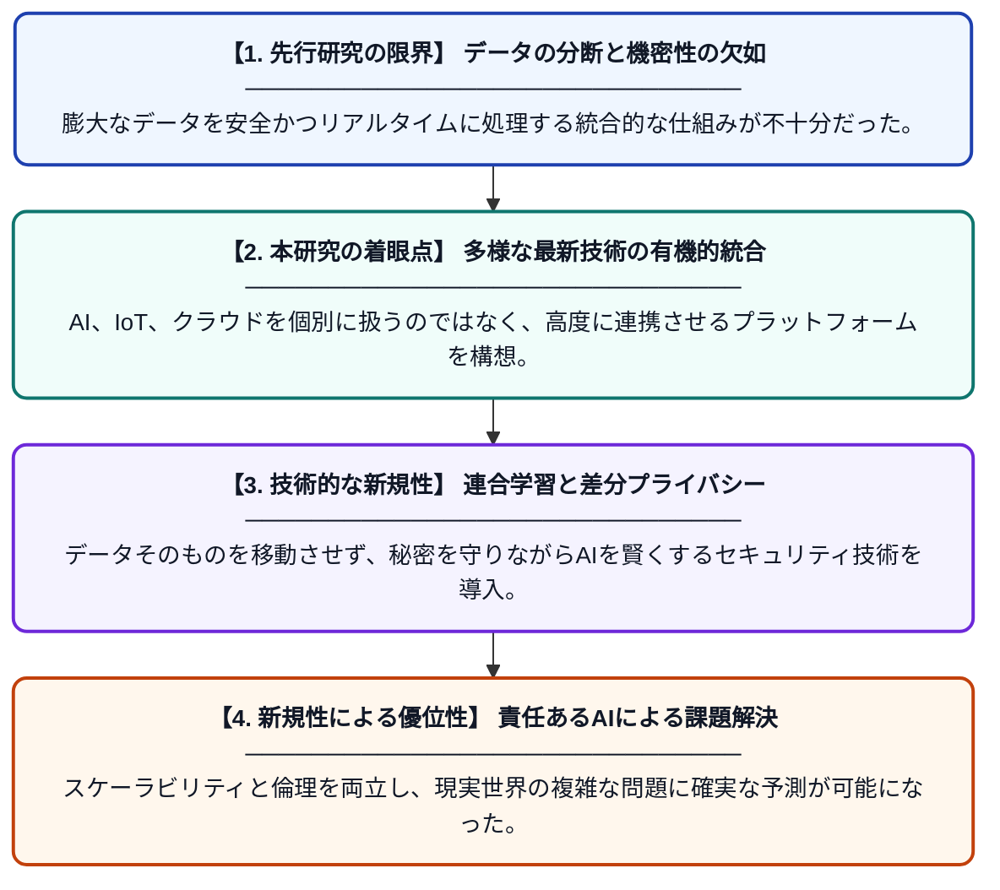

# AI駆動の知能システムと予測分析：ビッグデータ、深層学習、自動化、新興技術の統合による現実世界の課題解決

**Original Title**: *AI-Driven Intelligent Systems and Predictive Analytics: Integrating Big Data, Deep Learning, Automation, and Emerging Technologies for Real-World Problem Solving.*

> **💡 一言要約**: 最新AI技術を統合し、社会課題を安全に解決する

| 項目 | 内容 |
|---|---|
| **著者** | O Emmanuel |
| **アラートキーワード** | Secure Computing |
| **PDF** | [https://www.researchgate.net/profile/Oduola-Samuel/publication/417630721_AI-Driven_Intelligent_Systems_and_Predictive_Analytics_Integrating_Big_Data_Deep_Learning_Automation_and_Emerging_Technologies_for_Real-World_Problem_Solving/links/6af0a45edc41aa6ac310d50b/AI-Driven-Intelligent-Systems-and-Predictive-Analytics-Integrating-Big-Data-Deep-Learning-Automation-and-Emerging-Technologies-for-Real-World-Problem-Solving.pdf](https://www.researchgate.net/profile/Oduola-Samuel/publication/417630721_AI-Driven_Intelligent_Systems_and_Predictive_Analytics_Integrating_Big_Data_Deep_Learning_Automation_and_Emerging_Technologies_for_Real-World_Problem_Solving/links/6af0a45edc41aa6ac310d50b/AI-Driven-Intelligent-Systems-and-Predictive-Analytics-Integrating-Big-Data-Deep-Learning-Automation-and-Emerging-Technologies-for-Real-World-Problem-Solving.pdf) |
| **原文リンク** | [https://www.researchgate.net/profile/Oduola-Samuel/publication/417630721_AI-Driven_Intelligent_Systems_and_Predictive_Analytics_Integrating_Big_Data_Deep_Learning_Automation_and_Emerging_Technologies_for_Real-World_Problem_Solving/links/6af0a45edc41aa6ac310d50b/AI-Driven-Intelligent-Systems-and-Predictive-Analytics-Integrating-Big-Data-Deep-Learning-Automation-and-Emerging-Technologies-for-Real-World-Problem-Solving.pdf](https://www.researchgate.net/profile/Oduola-Samuel/publication/417630721_AI-Driven_Intelligent_Systems_and_Predictive_Analytics_Integrating_Big_Data_Deep_Learning_Automation_and_Emerging_Technologies_for_Real-World_Problem_Solving/links/6af0a45edc41aa6ac310d50b/AI-Driven-Intelligent-Systems-and-Predictive-Analytics-Integrating-Big-Data-Deep-Learning-Automation-and-Emerging-Technologies-for-Real-World-Problem-Solving.pdf) |
| **PDF版要約** | [README.pdf](./README.pdf) |

---

## 📊 新規性の図解（先行研究との違いと本研究のブレークスルー）

## 📝 要約

ビッグデータ、深層学習、IoT、生成AIなどの最新技術を統合し、現実世界の複雑な問題を解決するためのスケーラブルで安全な知能システムを提案しています。特に、データのプライバシーを保護する連合学習と差分プライバシーを組み合わせることで、責任あるAI開発の重要性を強調しています。

## ❓ どんな問題に取り組んだか

現代のデータは膨大かつ複雑であり、従来の分析手法ではリアルタイムな意思決定や高度な予測を行うことが困難になっています。また、大規模なシステムの運用において、データの機密性保持と透明性の確保を両立させる統合的な枠組みが不足していました。

## ✨ 何が新しい？何がすごい？（新規性）

クラウド、エッジコンピューティング、IoT、生成AIを一つのエコシステムとして統合し、スケーラブルな予測分析を実現した点が画期的です。特に、連合学習と差分プライバシーを融合させることで、データを外部に露出させずに学習精度を高める「プライバシー保護型AI」の構造を具体化しました。これにより、技術的な進化と倫理性・責任感を両立させる新しい標準を提示しています。

## 🎓 大学1年生向けの解説

私たちの生活を便利にするために、AIやインターネット（IoT）などの技術が使われていますが、これらをバラバラではなく「一つのチーム」として動かすのはとても難しいことです。この研究は、たくさんの最新技術を組み合わせて、未来を正しく予想する賢いシステムを作る方法を考えました。さらに、みんなのプライバシーをしっかり守りながら、誰でも安心して使えるような「責任感のあるAI」を目指しています。社会の難しい問題を解決するための、AIの新しい使い道を示した研究です。
