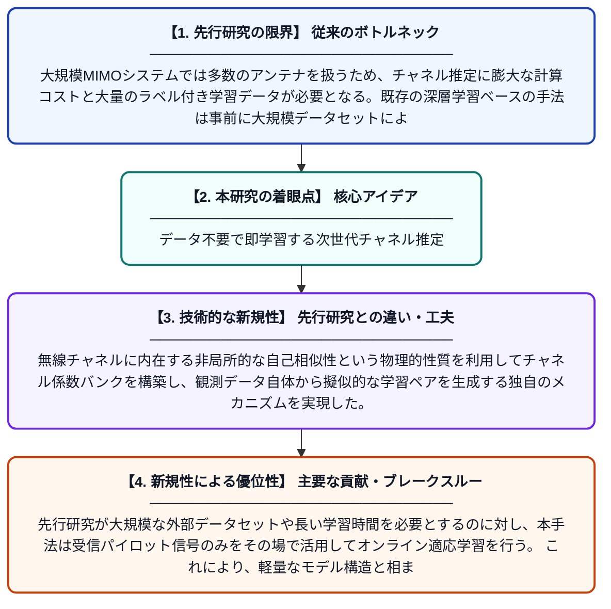

# 大規模MIMOにおける高速オンラインチャネル推定：ゼロショット自己教師あり学習アプローチ

**Original Title**: *Fast Online Channel Estimation in Massive MIMO: A Zero-Shot Self-Supervised Approach*

> **💡 一言要約**: データ不要で即学習する次世代チャネル推定

| 項目 | 内容 |
|---|---|
| **著者** | Z Gao, W Yi, F Benkhelifa, A Nallanathan |
| **掲載誌** | IEEE Transactions on Wireless Communications 2026 |
| **アラートキーワード** | zero shot |
| **PDF** | [https://repository.essex.ac.uk/43621/1/Fast%20Online%20Channel%20Estimation%20in%20Massive%20MIMO%20A%20Zero-Shot%20Self-Supervised%20Approach.pdf](https://repository.essex.ac.uk/43621/1/Fast%20Online%20Channel%20Estimation%20in%20Massive%20MIMO%20A%20Zero-Shot%20Self-Supervised%20Approach.pdf) |
| **原文リンク** | [https://repository.essex.ac.uk/43621/1/Fast%20Online%20Channel%20Estimation%20in%20Massive%20MIMO%20A%20Zero-Shot%20Self-Supervised%20Approach.pdf](https://repository.essex.ac.uk/43621/1/Fast%20Online%20Channel%20Estimation%20in%20Massive%20MIMO%20A%20Zero-Shot%20Self-Supervised%20Approach.pdf) |
| **PDF版要約** | [README.pdf](./README.pdf) |

---

## 📊 新規性の図解（先行研究との違いと本研究のブレークスルー）

## 📝 要約

本論文では、大規模MIMOシステムにおけるチャネル推定を効率的に行うための軽量なゼロショット自己教師あり（ZS-SS）学習フレームワークを提案する。無線チャネルが持つ非局所的な自己相似性を活用し、チャネル係数バンクを構築してランダム化・非連続サンプリングにより学習ペアを生成することで、事前学習データなしにリアルタイムでの推定を実現する。これにより、従来手法と比較して高速かつ高精度なチャネル推定が可能となる。

## ❓ どんな問題に取り組んだか

大規模MIMOシステムでは多数のアンテナを扱うため、チャネル推定に膨大な計算コストと大量のラベル付き学習データが必要となる。既存の深層学習ベースの手法は事前に大規模データセットによるオフライン学習を必要とし、実際の無線環境の変動に柔軟に対応することが難しい。特にオンライン環境でのリアルタイム推定は、速度と精度の両立という大きな課題を抱えている。

## ✨ 何が新しい？何がすごい？（新規性）

本研究は、いかなる事前学習データも必要としない「ゼロショット」の自己教師あり学習という新しいパラダイムをチャネル推定に導入した点が最大の貢献である。無線チャネルに内在する非局所的な自己相似性という物理的性質を利用してチャネル係数バンクを構築し、観測データ自体から擬似的な学習ペアを生成する独自のメカニズムを実現した。先行研究が大規模な外部データセットや長い学習時間を必要とするのに対し、本手法は受信パイロット信号のみをその場で活用してオンライン適応学習を行う。これにより、軽量なモデル構造と相まって計算コストを大幅に削減しつつ高精度な推定性能を達成している。

## 🎓 大学1年生向けの解説

スマートフォンで通信するとき、電波の状態（チャネル）を正確に把握することがとても重要です。この研究は、AIを使ってその電波状態をリアルタイムで素早く推定する新しい方法を提案しています。普通のAIは大量の「お手本データ」で事前に練習する必要がありますが、この手法はお手本データなしに、受信した電波の信号そのものを使って自分で学習します。電波は似たようなパターンが繰り返す性質があるため、それを利用して学習データを自動生成するという賢いアイデアです。これにより、次世代の高速通信（5G/6G）で多数のアンテナを使う大規模MIMOシステムを、より効率よく動かすことができるようになります。
