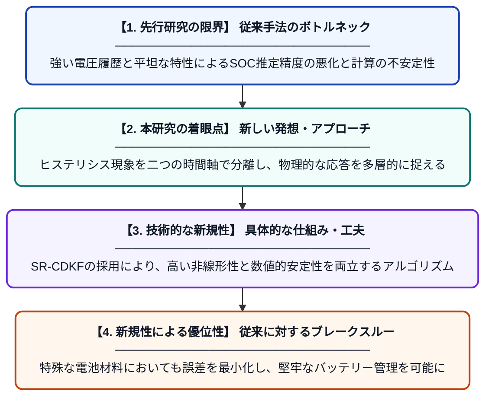

# 強力なヒステリシスを持つリチウムイオン電池の堅牢なSOC推定に向けた、平方根中心差分カルマンフィルタを用いた二重時間スケールヒステリシスモデリング

**Original Title**: *Dual-Timescale Hysteresis Modeling with a Square-Root Central Difference Kalman Filter for Robust State-of-Charge Estimation of Strongly Hysteretic Lithium-Ion …*

> **💡 一言要約**: 強いヒステリシスを持つ電池の残量を正確に特定

| 項目 | 内容 |
|---|---|
| **著者** | K Wang |
| **掲載誌** | 2026 |
| **アラートキーワード** | kalman filter |
| **PDF** | [https://assets-eu.researchsquare.com/files/rs-11685961/v1_covered_ac9df02d-1ce3-48e8-b8a6-d9dd79ddd4dc.pdf?c=1794479118](https://assets-eu.researchsquare.com/files/rs-11685961/v1_covered_ac9df02d-1ce3-48e8-b8a6-d9dd79ddd4dc.pdf?c=1794479118) |
| **原文リンク** | [https://www.researchsquare.com/article/rs-11685961/latest.pdf](https://www.researchsquare.com/article/rs-11685961/latest.pdf) |
| **PDF版要約** | [README.pdf](./README.pdf) |

---

## 📊 新規性の図解（先行研究との違いと本研究のブレークスルー）

## 📝 要約

リチウム過剰型やコンバージョン型電池のように強い電圧ヒステリシスや平坦な電圧特性を持つ次世代電池に対し、高精度な充電状態（SOC）推定を実現する手法を提案しています。二重時間スケールのヒステリシスモデルと平方根中心差分カルマンフィルタ（SR-CDKF）を組み合わせることで、複雑な充放電経路依存性を克服しています。

## ❓ どんな問題に取り組んだか

リチウム過剰型やLFP電池などは、充放電履歴によって電圧が大きく異なる「ヒステリシス特性」が強く、また電圧変化が極めて平坦な領域を持つため、従来のカルマンフィルタではSOC（充電状態）を正確に推定することが困難でした。特に非線形性が強い条件下では、計算の不安定化や推定精度の低下が大きな課題となっていました。

## ✨ 何が新しい？何がすごい？（新規性）

ヒステリシス現象を「高速」と「低速」の2つの時間スケールに分離して捉える動的なモデルを導入した点が最大の独自性です。さらに、数値的な安定性に優れる「平方根中心差分カルマンフィルタ（SR-CDKF）」を適用することで、計算過程での特異点の発生を抑えつつ、非線形性の強い電池挙動を精密に捉えています。これにより、従来の単一スケールモデルや拡張カルマンフィルタと比較して、過酷な動作環境下でも極めて高い推定精度と堅牢性を実現しました。

## 🎓 大学1年生向けの解説

スマホや電気自動車の電池残量（SOC）を当てるのは、実はとても難しい計算が必要です。特に最新の高性能な電池は、充電中か放電中かによって電圧が複雑に変わってしまうクセがあり、今までの方法では残量を読み間違えることがありました。この研究では、その複雑な変化を「すぐ起きる変化」と「ゆっくり起きる変化」の2つに分けて計算する新しい数学のモデルを作りました。さらに、計算ミスが起きにくい特別なアルゴリズムを使うことで、どんな状態でも正しく電池の残り時間を教えてくれる仕組みを開発しました。
