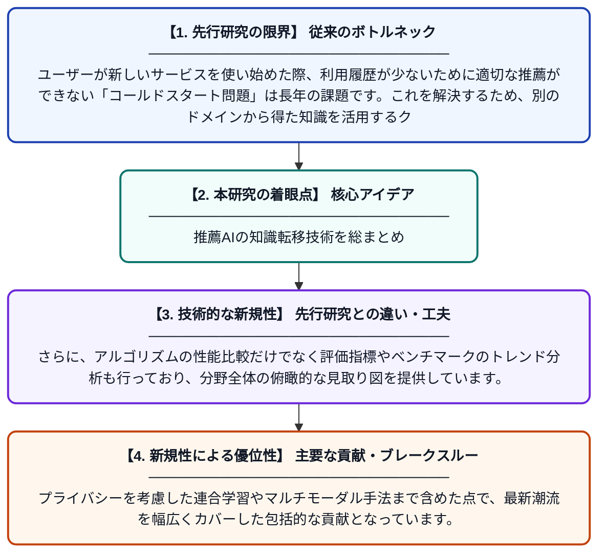

# クロスドメイン推薦システムにおけるアルゴリズム戦略：知識転移・表現学習・評価トレンドの比較レビュー

**Original Title**: *Algorithmic Strategies in Cross-Domain Recommender Systems: A Comparative Review of Knowledge Transfer, Representation Learning, and Evaluation Trends*

> **💡 一言要約**: 推薦AIの知識転移技術を総まとめ

| 項目 | 内容 |
|---|---|
| **著者** | AK Gahier, SK Gujral |
| **掲載誌** | Journal of Intelligent Decision Making and Information Systems 2026 |
| **アラートキーワード** | representation learning |
| **PDF** | [https://www.jidmis.org/index.php/jidmis/article/download/1034/294](https://www.jidmis.org/index.php/jidmis/article/download/1034/294) |
| **原文リンク** | [https://www.jidmis.org/index.php/jidmis/article/download/1034/294](https://www.jidmis.org/index.php/jidmis/article/download/1034/294) |
| **PDF版要約** | [README.pdf](./README.pdf) |

---

## 📊 新規性の図解（先行研究との違いと本研究のブレークスルー）

## 📝 要約

本論文は、異なるドメイン（例：映画と書籍）をまたいで機能する推薦システムに関する最新アルゴリズムを網羅的に比較・整理したサーベイ論文です。表現学習、グラフ手法、逐次モデリング、敵対的転移、自己教師あり学習、マルチモーダル転移、連合学習など多様なアルゴリズムファミリーを対象としています。各手法の強みと課題を体系的に分析し、評価指標や実験トレンドについても考察しています。

## ❓ どんな問題に取り組んだか

ユーザーが新しいサービスを使い始めた際、利用履歴が少ないために適切な推薦ができない「コールドスタート問題」は長年の課題です。これを解決するため、別のドメインから得た知識を活用するクロスドメイン推薦が注目されていますが、多様な手法が乱立しており、体系的な比較・整理が不足していました。

## ✨ 何が新しい？何がすごい？（新規性）

先行レビュー論文が特定の手法に偏っていたのに対し、本論文は表現学習からグラフニューラルネットワーク、連合学習まで現代的なアルゴリズムファミリーを横断的に網羅した点が新しいです。さらに、アルゴリズムの性能比較だけでなく評価指標やベンチマークのトレンド分析も行っており、分野全体の俯瞰的な見取り図を提供しています。プライバシーを考慮した連合学習やマルチモーダル手法まで含めた点で、最新潮流を幅広くカバーした包括的な貢献となっています。

## 🎓 大学1年生向けの解説

YouTubeやNetflixなどのアプリは、あなたの好みを学習して動画を推薦しています。しかし、新しいアプリを使い始めたばかりのときはデータが少なく、うまく推薦できません。そこで「別のアプリで得た情報を新しいアプリに活かす」というアイデアが生まれました。この論文は、そのような『ドメインをまたいだ知識の使い回し』を実現するさまざまなAI技術を整理・比較した『教科書のまとめ本』のような研究です。どの方法が何に向いているかをわかりやすく整理してくれているため、この分野の研究者にとって非常に参考になります。
