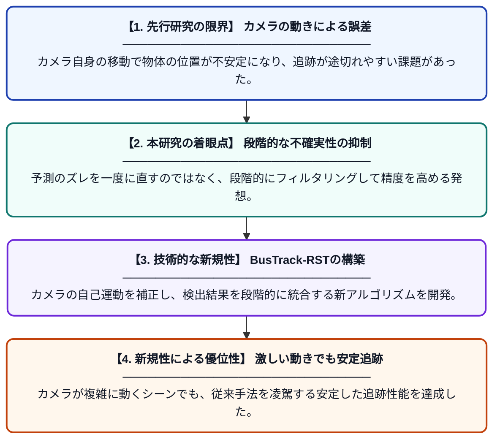

# BusTrack-RST: カメラの自己運動下でのオンライン複数物体追跡のための段階的不確実性抑制フレームワーク

**Original Title**: *BusTrack-RST: A progressive uncertainty suppression framework for online multi-object tracking under camera ego-motion*

> **💡 一言要約**: 動くカメラでも物体を逃さない、段階的追跡AI

| 項目 | 内容 |
|---|---|
| **著者** | W Gao, N Zou |
| **掲載誌** | Image and Vision Computing 2026 |
| **アラートキーワード** | Multi Camera Tracking |
| **原文リンク** | [https://www.sciencedirect.com/science/article/pii/S0262885626003616](https://www.sciencedirect.com/science/article/pii/S0262885626003616) |
| **PDF版要約** | [README.pdf](./README.pdf) |

---

## 📊 新規性の図解（先行研究との違いと本研究のブレークスルー）

## 📝 要約

カメラ自体が動く環境下での複数物体追跡（MOT）において、検出の不安定さや予測誤差を段階的に取り除く新しいフレームワーク「BusTrack-RST」を提案しました。カメラの動きを考慮しながら物体の位置予測を洗練させることで、複雑な動きの中でも高精度でリアルタイムな追跡を実現しています。

## ❓ どんな問題に取り組んだか

車載カメラやドローンのようにカメラ自体が激しく動く場合、物体の見かけ上の動きが不規則になり、AIによる検出漏れや位置予測のズレが頻発します。従来のオンライン追跡手法では、このカメラの自己運動から生じる不確実性を十分に処理できず、追跡対象を見失うという課題がありました。

## ✨ 何が新しい？何がすごい？（新規性）

本研究の最大の特徴は、不確実性を一度に解決しようとせず、段階的に抑制していく「プログレッシブ・サプレッション」を採用した点です。先行研究が静止カメラを前提としたり単純な補正に留まっていたのに対し、本手法はカメラの動きによる影響を精密に分離・統合し、予測モデルを動的に洗練させる仕組みを構築しました。これにより、検出が不完全なフレームでも過去のデータから最適な位置を導き出し、追跡の継続性を劇的に向上させています。

## 🎓 大学1年生向けの解説

歩きながら動画を撮ると、画面の中で追いかけている人が激しく揺れて見失いそうになりますよね。これはAIにとっても同じで、カメラが動くと物体の位置を正しく当てるのが難しくなります。この研究では、カメラの揺れを計算に入れつつ、少しずつ予測の「怪しい部分」を削ぎ落としていく魔法のような仕組みを作りました。これによって、カメラがどんなに動いても、追いかけたい人をピタッと正確に追い続けられるようになります。
