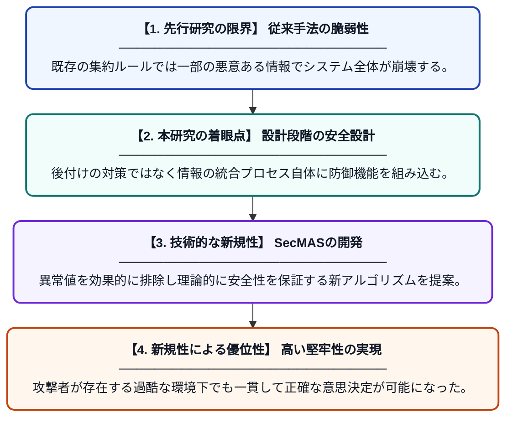

# 設計によるマルチエージェントシステムの保護：SecMASの提案

**Original Title**: *Securing Multi-Agent Systems by Design*

> **💡 一言要約**: 設計から守る、次世代マルチエージェント集約術

| 項目 | 内容 |
|---|---|
| **著者** | X Wang, X Chen, N Gong |
| **掲載誌** | arXiv preprint arXiv:2611.17883 2026 |
| **アラートキーワード** | multi agent |
| **PDF** | [https://arxiv.org/pdf/2611.17883](https://arxiv.org/pdf/2611.17883) |
| **原文リンク** | [https://arxiv.org/pdf/2611.17883](https://arxiv.org/pdf/2611.17883) |
| **PDF版要約** | [README.pdf](./README.pdf) |

---

## 📊 新規性の図解（先行研究との違いと本研究のブレークスルー）

## 📝 要約

マルチエージェントシステム（MAS）における情報の統合プロセスを保護するため、新たな集約ルール「SecMAS」を提案した論文です。既存の集約手法では攻撃者による操作を防ぎきれないことを示し、設計段階からセキュリティを組み込むことでシステム全体の堅牢性を高めています。

## ❓ どんな問題に取り組んだか

複数のエージェントが協力するシステムでは、一部のエージェントが攻撃を受けたり嘘の情報を発信したりすると、システム全体の意思決定が容易に崩壊してしまいます。従来の集約ルールはこうした攻撃に対して脆弱であり、信頼性を確保することが困難でした。

## ✨ 何が新しい？何がすごい？（新規性）

本研究の核心は、攻撃耐性を備えた新しい集約ルール「SecMAS」を開発した点にあります。先行研究が特定の攻撃への対症療法に留まっていたのに対し、SecMASは設計段階からセキュリティを考慮することで、より広範な攻撃シナリオに対して強固な理論的保証を提供します。実験を通じて、標準的な手法よりも圧倒的に高い生存性と精度を維持できることを実証しました。

## 🎓 大学1年生向けの解説

複数のロボットやAIがチームで動くとき、一人が嘘をつくとチーム全体が失敗してしまいます。この研究では、誰かが嘘をついていても、それを上手く無視して正しい答えを見つけ出す「SecMAS」という新しい計算のルールを作りました。これにより、チームの中に意地悪なエージェントが混ざっていても、みんなで正しく安全に動き続けることができるようになります。
