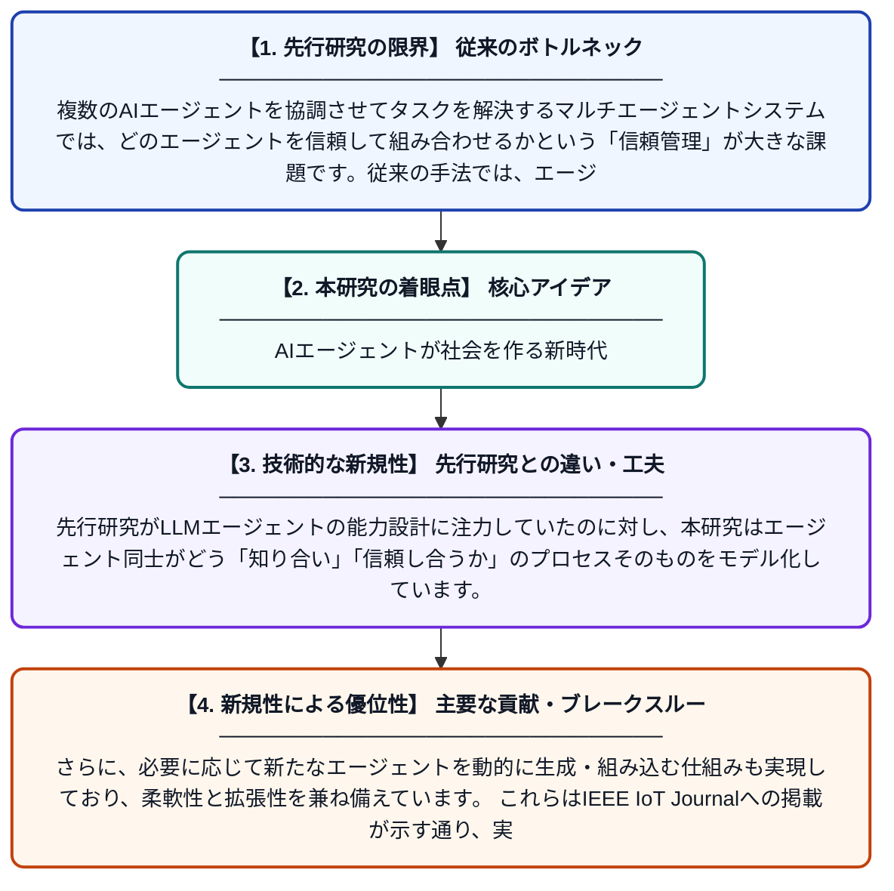

# 社会的関係に基づく効果的なLLMエージェント発見と信頼できるマルチエージェントシステムの動的構築のための新しいパラダイム

**Original Title**: *A new paradigm for effective LLM-Agent discovery and dynamic creation of trusted Multi-Agent Systems based on social relationships*

> **💡 一言要約**: AIエージェントが社会を作る新時代

| 項目 | 内容 |
|---|---|
| **著者** | M Becattini, EG Biondino, E Vicario, A Iera |
| **掲載誌** | IEEE Internet of Things Journal 2026 |
| **アラートキーワード** | multi agent |
| **PDF** | [https://ieeexplore.ieee.org/iel8/6488907/6702522/11622503.pdf](https://ieeexplore.ieee.org/iel8/6488907/6702522/11622503.pdf) |
| **原文リンク** | [https://ieeexplore.ieee.org/iel8/6488907/6702522/11622503.pdf](https://ieeexplore.ieee.org/iel8/6488907/6702522/11622503.pdf) |
| **PDF版要約** | [README.pdf](./README.pdf) |

---

## 📊 新規性の図解（先行研究との違いと本研究のブレークスルー）

## 📝 要約

本論文は、大規模言語モデル（LLM）を活用したエージェントを動的に発見・組み合わせ、信頼性の高いマルチエージェントシステムを構築する新しい枠組みを提案しています。エージェント間の「社会的関係」という概念を導入することで、エージェントどうしの信頼度を評価し、複雑な問題解決に適した構成を自律的に形成します。IoT環境を想定した実装においても、その有効性が示されています。

## ❓ どんな問題に取り組んだか

複数のAIエージェントを協調させてタスクを解決するマルチエージェントシステムでは、どのエージェントを信頼して組み合わせるかという「信頼管理」が大きな課題です。従来の手法では、エージェントの動的な発見や信頼関係の評価が十分に自動化されておらず、大規模なIoT環境への適用が困難でした。

## ✨ 何が新しい？何がすごい？（新規性）

本研究は、人間社会における信頼形成の仕組みをエージェント間関係に応用し、「社会的関係」に基づく信頼スコアを動的に更新するメカニズムを新たに提案しました。先行研究がLLMエージェントの能力設計に注力していたのに対し、本研究はエージェント同士がどう「知り合い」「信頼し合うか」のプロセスそのものをモデル化しています。さらに、必要に応じて新たなエージェントを動的に生成・組み込む仕組みも実現しており、柔軟性と拡張性を兼ね備えています。これらはIEEE IoT Journalへの掲載が示す通り、実システムへの応用可能性も高いものです。

## 🎓 大学1年生向けの解説

AIには「エージェント」と呼ばれる、自分で考えて行動するプログラムがあります。この研究では、複数のエージェントがチームを組んで難しい問題を解決する仕組みを作りました。ポイントは、エージェント同士が「友達かどうか」「信頼できるか」を判断する、人間の社会関係に似た仕組みを取り入れた点です。これにより、知らないエージェントとも安全に協力できるチームが自動で作られます。スマート家電などがつながるIoTの世界でも使える実用的な技術です。
