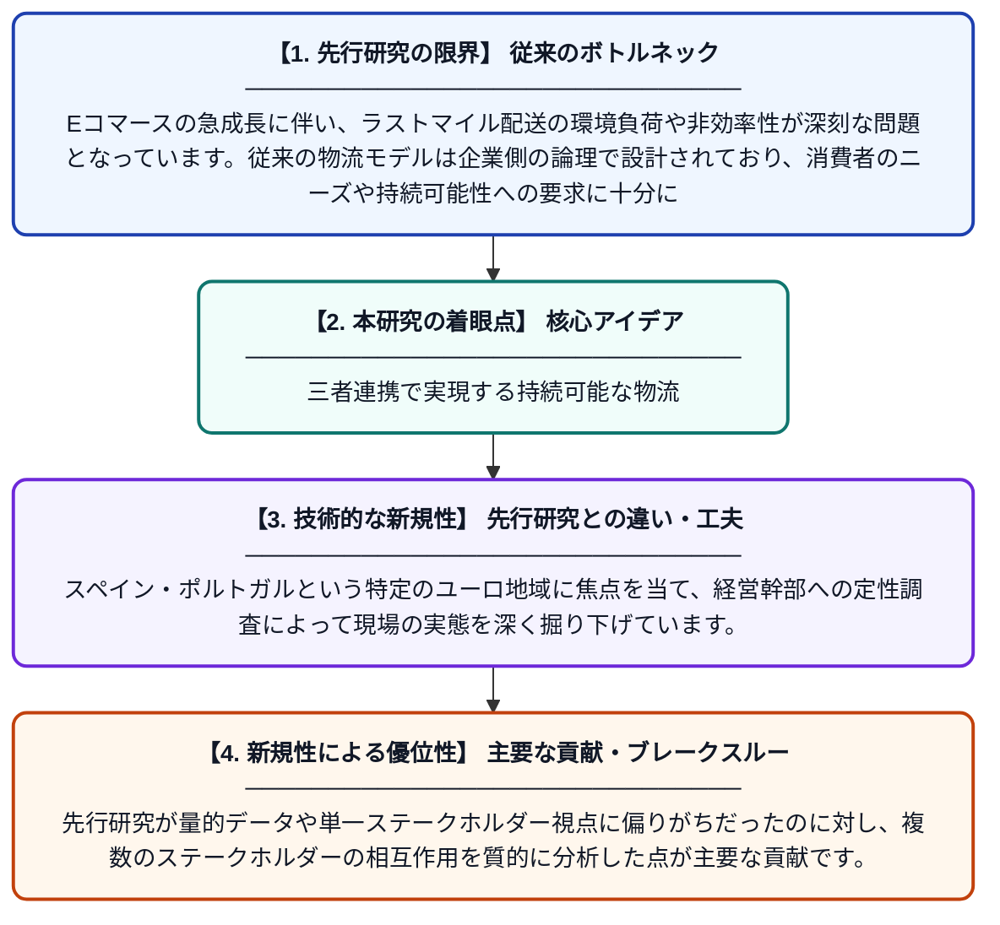

# 持続可能なEコマース物流における価値共創：顧客中心型ビジネスモデルに向けて

**Original Title**: *Value Co-Creation in Sustainable E-Commerce Logistics: Toward Customer-Centric Business Models*

> **💡 一言要約**: 三者連携で実現する持続可能な物流

| 項目 | 内容 |
|---|---|
| **著者** | J Turienzo |
| **掲載誌** | Journal of Internet Commerce 2026 |
| **アラートキーワード** | logistics |
| **原文リンク** | [https://www.tandfonline.com/doi/abs/10.1080/15332861.2026.2702916](https://www.tandfonline.com/doi/abs/10.1080/15332861.2026.2702916) |
| **PDF版要約** | [README.pdf](./README.pdf) |

---

## 📊 新規性の図解（先行研究との違いと本研究のブレークスルー）

## 📝 要約

本研究は、スペイン・ポルトガルのユーロ地域における29名の経営幹部への定性的インタビューを通じて、持続可能なEコマース物流における消費者の好みと物流戦略を探求しています。小売業者・物流プロバイダー・消費者の間での「価値共創」が、持続可能な物流モデルを実現する上での重要な推進力として浮かび上がっています。顧客中心のビジネスモデル構築に向けた実践的な示唆を提供しています。

## ❓ どんな問題に取り組んだか

Eコマースの急成長に伴い、ラストマイル配送の環境負荷や非効率性が深刻な問題となっています。従来の物流モデルは企業側の論理で設計されており、消費者のニーズや持続可能性への要求に十分に応えられていませんでした。小売業者・物流会社・消費者がどのように協力して、より環境に優しく効率的な配送を実現できるかが課題となっていました。

## ✨ 何が新しい？何がすごい？（新規性）

本研究は、物流の持続可能性を「企業単体の取り組み」ではなく、小売業者・物流プロバイダー・消費者の三者による「価値共創」という枠組みで捉えた点が新しいアプローチです。スペイン・ポルトガルという特定のユーロ地域に焦点を当て、経営幹部への定性調査によって現場の実態を深く掘り下げています。先行研究が量的データや単一ステークホルダー視点に偏りがちだったのに対し、複数のステークホルダーの相互作用を質的に分析した点が主要な貢献です。

## 🎓 大学1年生向けの解説

ネットショッピングが普及するにつれて、荷物を届けるための物流（配送の仕組み）が環境に与える影響がとても大きくなっています。この研究では、「どうすればお客さんにとって便利で、かつ環境にも優しい配送ができるか」を探っています。重要なのは、お店・配送会社・お客さんの三者が協力して一緒に良いサービスを作り上げる「価値共創」という考え方です。スペインとポルトガルで働く会社の偉い人たち29名に話を聞き、実際のビジネス現場の声をもとに分析しました。この研究は、環境に配慮しながらもお客さんが満足できる新しいビジネスの形を考えるヒントを提供しています。
