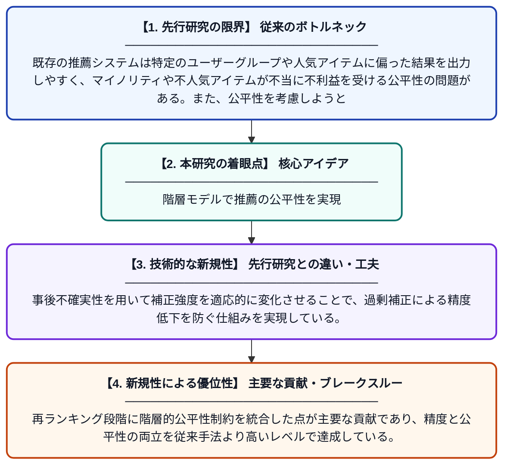

# 推薦システムにおける階層的公平性考慮型再ランキング手法

**Original Title**: *Hierarchical Fairness-Aware Re-Ranking for Recommender Systems*

> **💡 一言要約**: 階層モデルで推薦の公平性を実現

| 項目 | 内容 |
|---|---|
| **著者** | G Dorleon, S Shujaa |
| **掲載誌** | Expert Systems with Applications 2026 |
| **アラートキーワード** | Bayesian hierarchical ... |
| **原文リンク** | [https://www.sciencedirect.com/science/article/pii/S0957417426026801](https://www.sciencedirect.com/science/article/pii/S0957417426026801) |
| **PDF版要約** | [README.pdf](./README.pdf) |

---

## 📊 新規性の図解（先行研究との違いと本研究のブレークスルー）

## 📝 要約

本論文は、推薦システムにおける公平性を実現するため、ベイズ階層モデルを用いてカテゴリへの親和性をグローバル・グループ・個人レベルに分解する手法を提案する。事後不確実性を活用して公平性補正を適応的に調整することで、精度と公平性のトレードオフを改善する。再ランキング段階で階層的公平性制約を組み込むことにより、多様なユーザー集団に対して公平かつ高精度な推薦を実現する。

## ❓ どんな問題に取り組んだか

既存の推薦システムは特定のユーザーグループや人気アイテムに偏った結果を出力しやすく、マイノリティや不人気アイテムが不当に不利益を受ける公平性の問題がある。また、公平性を考慮しようとすると推薦精度が大きく低下するというトレードオフが未解決のまま残されていた。

## ✨ 何が新しい？何がすごい？（新規性）

先行研究が一律の公平性補正を適用するのに対し、本研究はベイズ階層モデルによってグローバル・グループ・個人の3レベルでカテゴリ親和性を分解するという新しいアプローチを採用した。事後不確実性を用いて補正強度を適応的に変化させることで、過剰補正による精度低下を防ぐ仕組みを実現している。再ランキング段階に階層的公平性制約を統合した点が主要な貢献であり、精度と公平性の両立を従来手法より高いレベルで達成している。

## 🎓 大学1年生向けの解説

YouTubeやAmazonなどのおすすめ機能（推薦システム）は、人気のある商品や動画ばかりを優遇してしまい、特定のグループが不公平に扱われることがあります。この研究では、ユーザーの好みを「全体の傾向」「グループの傾向」「個人の傾向」の3段階に分けて細かく分析する方法を考えました。さらに、どれくらい自信を持って公平性を調整すべきかを自動的に判断することで、おすすめの精度を落とさずに公平性を高めることに成功しています。まるで、みんなに平等でありながら一人ひとりの好みにも合ったおすすめをしてくれる賢い仕組みを作ったようなイメージです。
