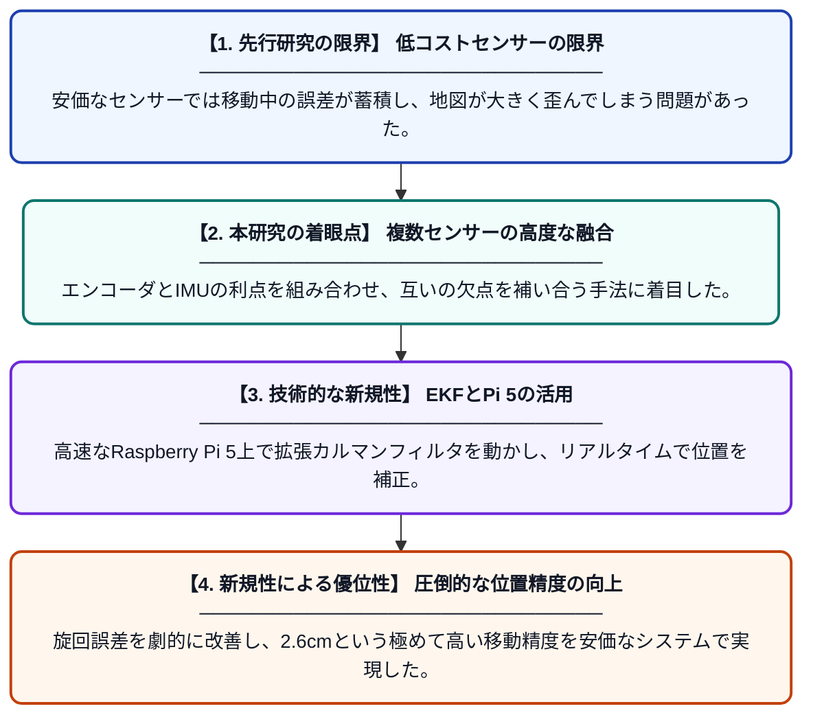

# LiDAR、ROS 2、Raspberry Pi 5を用いた救助活動用地図作成ロボット

**Original Title**: *Map-Making Robot for Rescue Operations Using LiDAR, ROS 2 and Raspberry Pi 5*

> **💡 一言要約**: 最新ラズパイで救助用地図を正確に描く

| 項目 | 内容 |
|---|---|
| **著者** | NH Thet, PP Thu, VC Udegbu, A Bhattarai… |
| **掲載誌** | IEEE 14th Conference … 2026 |
| **アラートキーワード** | kalman filter |
| **原文リンク** | [https://ieeexplore.ieee.org/abstract/document/11791270/](https://ieeexplore.ieee.org/abstract/document/11791270/) |
| **PDF版要約** | [README.pdf](./README.pdf) |

---

## 📊 新規性の図解（先行研究との違いと本研究のブレークスルー）

## 📝 要約

最新のRaspberry Pi 5とROS 2を搭載し、救助活動を支援するための高精度な地図作成ロボットを開発しました。拡張カルマンフィルタ（EKF）を用いて車輪エンコーダとIMUのデータを融合し、自己位置推定の誤差を大幅に削減することに成功しています。

## ❓ どんな問題に取り組んだか

災害現場のような複雑な環境では、ロボットが自分の位置を正確に把握できず、作成される地図に大きなズレが生じることが課題でした。特に、安価なセンサーだけでは旋回時や移動時の誤差が蓄積しやすく、実用的な地図を作るのが困難でした。

## ✨ 何が新しい？何がすごい？（新規性）

最新のRaspberry Pi 5の高い処理能力を活かし、ROS 2環境下で高度なセンサー融合を実現しました。拡張カルマンフィルタ（EKF）により、エンコーダのオドメトリとIMUの角速度データを最適に統合し、方位角の誤差を従来手法から劇的に改善しています。具体的には、1.12mの移動に対して平均線形誤差2.6cm、方位角誤差3.6度という、低コストな構成ながら極めて高い精度を達成しました。

## 🎓 大学1年生向けの解説

災害現場などで人間の代わりに中を調べて地図を作ってくれるロボットの研究です。最新の小型コンピューター「Raspberry Pi 5」を頭脳として使い、レーザーで周りを測るセンサー（LiDAR）を搭載しています。タイヤが回った距離と、ロボットの向きを感じるセンサーの情報を数学的な工夫（EKF）で組み合わせることで、自分がどこにいるかを非常に正確に把握できるようになりました。これにより、複雑な場所でもズレの少ない正しい地図を自動で作ることができます。
