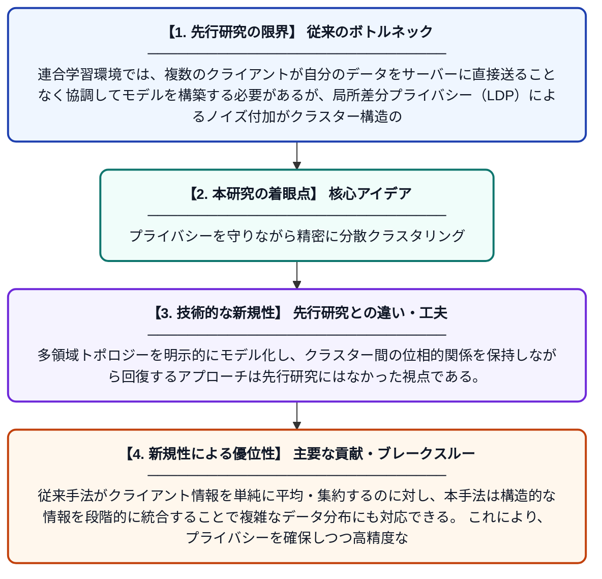

# 混合前に抽出：局所差分プライバシー下でのワンショット連合クラスタリングにおける多領域トポロジー考慮型回復手法

**Original Title**: *Extract-before-mix: Multi-domain topology-aware recovery for one-shot federated clustering under local differential privacy*

> **💡 一言要約**: プライバシーを守りながら精密に分散クラスタリング

| 項目 | 内容 |
|---|---|
| **著者** | Y Li, X Fu, L Liu, J Ding, W Peng |
| **掲載誌** | Neurocomputing 2026 |
| **アラートキーワード** | differential privacy |
| **原文リンク** | [https://www.sciencedirect.com/science/article/pii/S0925231226020370](https://www.sciencedirect.com/science/article/pii/S0925231226020370) |
| **PDF版要約** | [README.pdf](./README.pdf) |

---

## 📊 新規性の図解（先行研究との違いと本研究のブレークスルー）

## 📝 要約

本論文は、局所差分プライバシー（LDP）制約下でのワンショット連合クラスタリングにおいて、クライアントが送信するプライバシー保護済みの要約情報からサーバーがグローバルなクラスター構造を正確に復元する新手法を提案する。既存の重心集約・場集約手法が多領域・複雑トポロジーのデータに対して限界を持つ問題に対し、「先に抽出してから混合する」という戦略でクラスター構造を段階的に回復する。提案手法は複数ドメインにわたるデータの位相的特性を考慮することで、従来手法より高精度なクラスタリングを実現する。

## ❓ どんな問題に取り組んだか

連合学習環境では、複数のクライアントが自分のデータをサーバーに直接送ることなく協調してモデルを構築する必要があるが、局所差分プライバシー（LDP）によるノイズ付加がクラスター構造の回復精度を著しく低下させる。特に、データが複数の領域にまたがる複雑なトポロジー（形状・分布）を持つ場合、従来の重心集約や確率場集約手法では正確なクラスター構造を再現することが困難であった。また、通信コスト削減のためにワンショット（1回の通信のみ）という制約が加わるとさらに問題が深刻化する。

## ✨ 何が新しい？何がすごい？（新規性）

本研究は「混合前に抽出（Extract-before-mix）」という新しいパラダイムを提案し、集約前に各クライアントのローカルなクラスター構造をドメインごとに独立して抽出することで、ノイズの影響を局所的に抑制する点が新しい。多領域トポロジーを明示的にモデル化し、クラスター間の位相的関係を保持しながら回復するアプローチは先行研究にはなかった視点である。従来手法がクライアント情報を単純に平均・集約するのに対し、本手法は構造的な情報を段階的に統合することで複雑なデータ分布にも対応できる。これにより、プライバシーを確保しつつ高精度なグローバルクラスタリングをワンショット通信で実現するという、実用性の高い貢献を示している。

## 🎓 大学1年生向けの解説

たとえば、複数の病院がそれぞれの患者データを外部に漏らさずに、「患者グループ（クラスター）」を共同で発見したいとします。これが連合クラスタリングという問題です。しかし、プライバシーを守るためにデータにわざとノイズ（ランダムなゆがみ）を加えると、グループの構造が見えにくくなってしまいます。この論文では、各病院がデータを送る前にまず自分たちのグループ構造を整理（抽出）してから、サーバーで組み合わせる（混合）という工夫によって、1回の通信だけでもプライバシーを守りながら正確なグループ発見ができる方法を開発しました。
