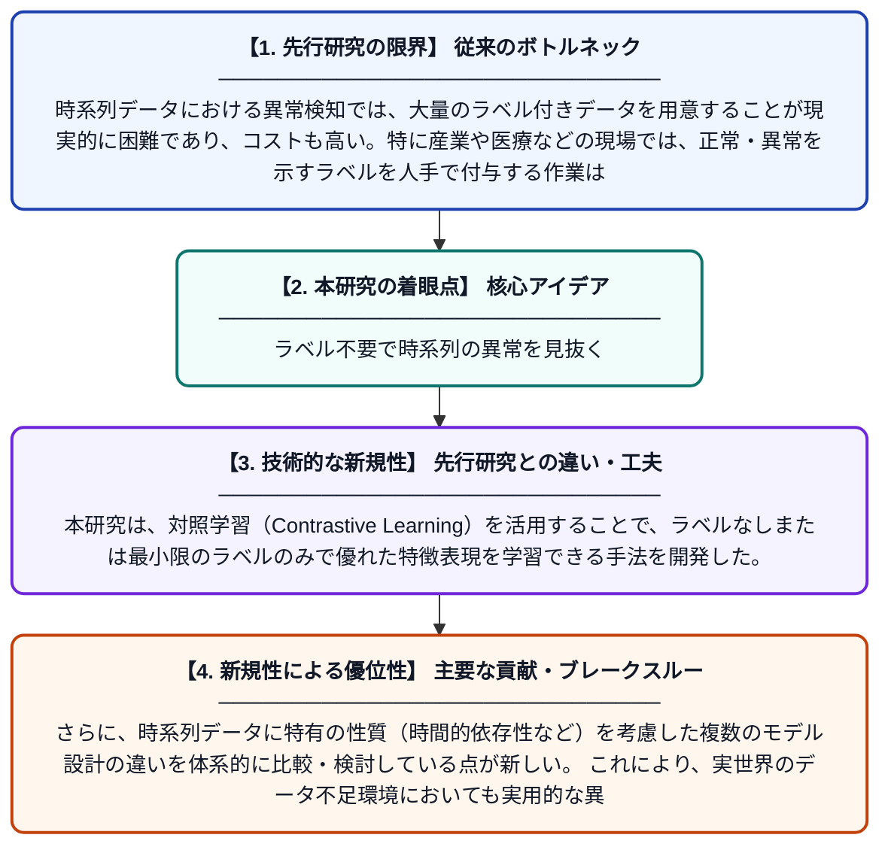

# 対照表現学習を用いた時系列異常検知モデル

**Original Title**: *Time series anomaly detection models with contrastive representation learning*

> **💡 一言要約**: ラベル不要で時系列の異常を見抜く

| 項目 | 内容 |
|---|---|
| **著者** | F Quijada, K Drobnyh, G Runger |
| **掲載誌** | Journal of Intelligent Information Systems 2026 |
| **アラートキーワード** | representation learning |
| **原文リンク** | [https://link.springer.com/article/10.1007/s10844-026-01078-z](https://link.springer.com/article/10.1007/s10844-026-01078-z) |
| **PDF版要約** | [README.pdf](./README.pdf) |

---

## 📊 新規性の図解（先行研究との違いと本研究のブレークスルー）

## 📝 要約

本研究は、完全なデータラベリングを必要としない教師なし・自己教師あり対照学習に基づく時系列表現学習手法を提案する。時系列データに特有のモデルの違いを比較・分析し、異常検知の精度向上を目指している。ラベルなしデータからでも効果的な特徴表現を獲得できる点が特長である。

## ❓ どんな問題に取り組んだか

時系列データにおける異常検知では、大量のラベル付きデータを用意することが現実的に困難であり、コストも高い。特に産業や医療などの現場では、正常・異常を示すラベルを人手で付与する作業は非常に労力がかかる。こうした制約のもとでも高精度な異常検知を実現するモデルの構築が求められていた。

## ✨ 何が新しい？何がすごい？（新規性）

先行研究では異常検知に教師あり学習が主流であり、多くのラベル付きデータが必要だった。本研究は、対照学習（Contrastive Learning）を活用することで、ラベルなしまたは最小限のラベルのみで優れた特徴表現を学習できる手法を開発した。さらに、時系列データに特有の性質（時間的依存性など）を考慮した複数のモデル設計の違いを体系的に比較・検討している点が新しい。これにより、実世界のデータ不足環境においても実用的な異常検知システムの構築が可能となる。

## 🎓 大学1年生向けの解説

たとえば工場の機械や体の心拍数のような「時間の流れに沿ったデータ」から、おかしな動き（異常）を自動で見つけるのがこの研究のテーマです。普通、AIに異常を学習させるには「これは正常」「これは異常」という正解ラベルを大量に用意する必要がありますが、それはとても大変です。この研究では、「対照学習」という技術を使い、正解ラベルがほとんどなくてもAIが自分でデータの特徴をうまく学べる仕組みを作りました。似たデータは近く、違うデータは遠くなるように学習させることで、異常なパターンを自然に検出できるようにしています。
