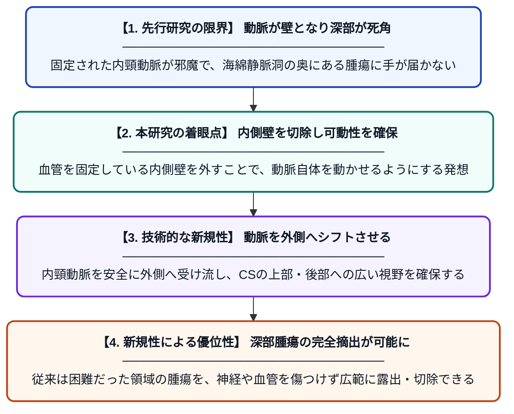

# 機能性下垂体腺腫における海綿静脈洞内側壁の選択的切除：内側から外側への海綿静脈洞への扉を開く

**Original Title**: *Selective resection of the cavernous sinus medial wall in functional pituitary adenomas: opening the gate to the cavernous sinus from medial to lateral*

> **💡 一言要約**: 壁を除去し動脈を動かす、海綿静脈洞手術の新境地

| 項目 | 内容 |
|---|---|
| **著者** | X Han, L Zong, H Yang, B Li, Z Wang, L Yang, J Yu… |
| **掲載誌** | Journal of Neurosurgery 2026 |
| **アラートキーワード** | ICA |
| **原文リンク** | [https://thejns.org/view/journals/j-neurosurg/aop/article-10.3171-2026.5.JNS252348/article-10.3171-2026.5.JNS252348.xml](https://thejns.org/view/journals/j-neurosurg/aop/article-10.3171-2026.5.JNS252348/article-10.3171-2026.5.JNS252348.xml) |
| **PDF版要約** | [README.pdf](./README.pdf) |

---

## 📊 新規性の図解（先行研究との違いと本研究のブレークスルー）

## 📝 要約

海綿静脈洞（CS）の内側壁を選択的に切除することで、内部を通る内頸動脈の可動性を高め、CS深部へのアクセスを劇的に改善する新しい手術手法を提案しています。この手法により、従来は困難だったCSの上部および後部区画に存在する腫瘍の広範な露出と安全な摘出が可能になります。

## ❓ どんな問題に取り組んだか

海綿静脈洞（CS）は重要な神経や血管が密集しており、下垂体腺腫が侵入した場合の完全摘出が極めて困難な領域です。特にCS内部の奥深くに腫瘍がある場合、太い内頸動脈（ICA）が障害物となり、視認性や器具の操作が大幅に制限されるという課題がありました。

## ✨ 何が新しい？何がすごい？（新規性）

本研究の画期的な点は、CSの内側壁（MWCS）をあえて切除することで、内頸動脈（ICA）を外側へ「移動可能な状態」にしたことです。従来は固定されていた動脈の可動性を確保し、吸引管などで優しく横に寄せる（mobilization）ことで、CS内の上部や後部といった死角となっていた領域を広範囲に露出させることに成功しました。これにより、動脈の裏側に隠れた腫瘍への直接的なアプローチを可能にしました。

## 🎓 大学1年生向けの解説

脳の真ん中付近には「海綿静脈洞」という、大事な血管や神経が詰まった複雑な場所があります。ここに腫瘍ができると、太い血管（内頸動脈）が邪魔で腫瘍を全部取り除くのが非常に大変でした。この研究では、血管を固定している「壁」をあえて取り除くことで、血管を少し横に避けて通り道を作る方法を開発しました。これにより、今まで血管の影に隠れて見えなかった腫瘍をしっかり見て、安全に取り除くことができるようになります。
