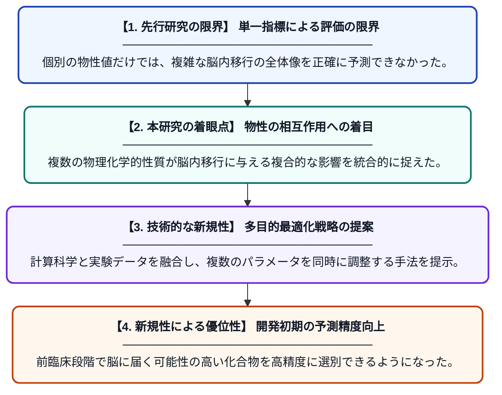

# 創薬の初期段階における脳内移行性向上のための物理化学的性質の戦略的最適化

**Original Title**: *Strategic optimization of physicochemical properties for enhanced brain exposure in preclinical drug discovery*

> **💡 一言要約**: 多角的な物性最適化で脳に届く薬を設計する

| 項目 | 内容 |
|---|---|
| **著者** | T Vallianatou, A Tsantili-Kakoulidou |
| **掲載誌** | Expert Opinion on Drug Discovery 2026 |
| **アラートキーワード** | optimization |
| **原文リンク** | [https://www.tandfonline.com/doi/abs/10.1080/17460441.2026.2762811](https://www.tandfonline.com/doi/abs/10.1080/17460441.2026.2762811) |
| **PDF版要約** | [README.pdf](./README.pdf) |

---

## 📊 新規性の図解（先行研究との違いと本研究のブレークスルー）

## 📝 要約

脳への薬物移行性を高めるためには、化合物の物理化学的性質を多角的に最適化する必要があります。本論文では、前臨床段階において複雑な脳内曝露を改善するための戦略を提示し、将来的には多目的な統合最適化アプローチが必要であることを論じています。

## ❓ どんな問題に取り組んだか

多くの新薬候補は、血液脳関門を通過して脳組織に十分な量を届けることができず、開発が難航しています。脳内移行性は複数の物性が絡み合う複雑な現象であり、一つの指標を改善するだけでは不十分であるという課題があります。

## ✨ 何が新しい？何がすごい？（新規性）

本論文は、個別の物理化学的指標に頼る従来の手法から脱却し、複数のパラメータを同時に最適化する「多目的最適化」の重要性を強調しています。創薬の極めて初期段階から脳内曝露を統合的に予測・設計する戦略的枠組みを提案した点が大きな貢献です。これにより、開発後期での失敗リスクを低減し、効率的な脳疾患治療薬の創出が可能になります。

## 🎓 大学1年生向けの解説

脳には、有害な物質が入り込まないように守る強力なバリヤーがあり、これが薬を届ける際の大きな壁になっています。この論文は、薬が「どのくらい脂に溶けやすいか」や「分子の大きさ」などの性質を、パズルのようにどう組み合わせればこの壁を通り抜けられるかを解説しています。これまでは個別に考えられていた性質を、まとめて一気に最適化する新しい考え方を提案しています。これにより、将来、脳の病気を治す薬をより確実に見つけられるようになります。
