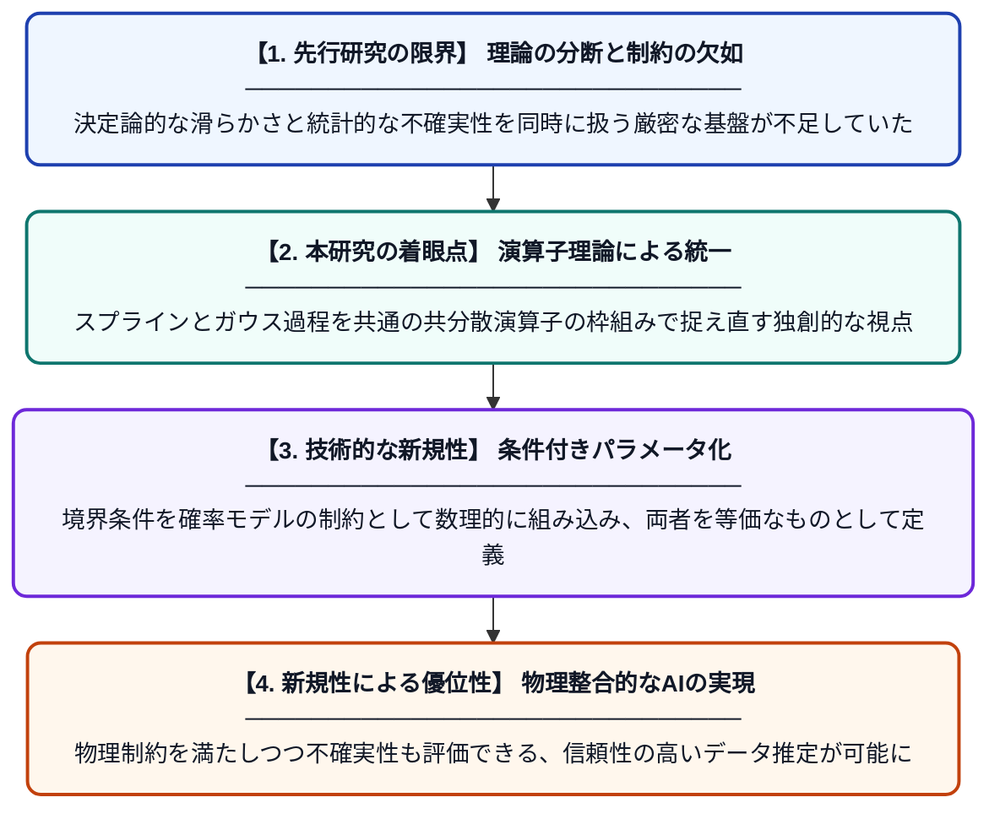

# 変分スプラインと一般化ガウス過程

**Original Title**: *Variational splines and generalized gaussian processes*

> **💡 一言要約**: スプラインとガウス過程を繋ぐ革新的な統一理論

| 項目 | 内容 |
|---|---|
| **著者** | M Unser |
| **掲載誌** | arXiv preprint arXiv:2611.06233 2026 |
| **アラートキーワード** | gaussian process |
| **PDF** | [https://arxiv.org/pdf/2611.06233](https://arxiv.org/pdf/2611.06233) |
| **原文リンク** | [https://arxiv.org/pdf/2611.06233](https://arxiv.org/pdf/2611.06233) |
| **PDF版要約** | [README.pdf](./README.pdf) |

---

## 📊 新規性の図解（先行研究との違いと本研究のブレークスルー）

## 📝 要約

決定論的な補間手法である変分スプラインと、統計的な推定手法であるガウス過程を数学的に統合した研究です。境界条件を組み込んだ共分散演算子を用いることで、これら二つの異なるアプローチが同一の理論的枠組みで記述できることを示しました。

## ❓ どんな問題に取り組んだか

従来、データを滑らかに補完するスプライン理論と、不確実性をモデル化するガウス過程は、異なる数学的背景を持つものとして扱われてきました。特に、物理的な制約（境界条件）を維持しながらこれら両方の利点を活かすための統一的な数理モデルが欠けていました。

## ✨ 何が新しい？何がすごい？（新規性）

本論文の最大の特徴は、境界条件をパラメータ化された条件付けとして捉え、共分散演算子を再定義することで、変分スプラインを一般化ガウス過程の平均値（MAP推定）として数学的に証明した点にあります。先行研究では困難だった無限次元の関数空間における統計的推定を、ヒルベルト空間の理論を用いて厳密に定式化しました。これにより、決定論的な最適化と確率的な推論の橋渡しに成功しています。

## 🎓 大学1年生向けの解説

散らばった点の間を滑らかな線でつなぐ技術（スプライン）と、AIがデータの「もっともらしさ」を計算する技術（ガウス過程）は、実は表裏一体の関係にあることを示した研究です。例えば、建物の揺れを予測するとき、物理的なルール（境界条件）を守りながら、同時にデータの不確かさも計算できるようになります。この論文は、全く別物に見えた二つの計算方法が、同じ数学の言葉で説明できることを明らかにしました。
