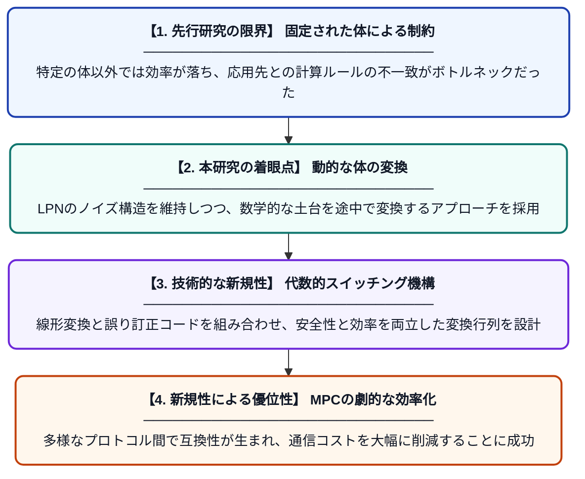

# LPN問題における体（フィールド）の切り替え技術

**Original Title**: *Field Switching in Learning Parity with Noise*

> **💡 一言要約**: LPNの計算を異なる数学的世界の間で自在に変換

| 項目 | 内容 |
|---|---|
| **著者** | M Ball, S Erabelli, M Wang |
| **掲載誌** | Theory of Cryptography |
| **アラートキーワード** | Secure Computing |
| **原文リンク** | [https://link.springer.com/content/pdf/10.1007/978-3-032-43588-0.pdf#page=403](https://link.springer.com/content/pdf/10.1007/978-3-032-43588-0.pdf#page=403) |
| **PDF版要約** | [README.pdf](./README.pdf) |

---

## 📊 新規性の図解（先行研究との違いと本研究のブレークスルー）

## 📝 要約

暗号理論の基礎であるLPN問題において、計算の土台となる有限体を柔軟に切り替える新しいフレームワークを提案しています。これにより、効率的な擬似乱数相関生成器（PCG）を多様な数学的設定を持つ安全なマルチパーティ計算（MPC）へ適用することが容易になります。

## ❓ どんな問題に取り組んだか

従来のLPNは主に2進体や特定の素数体上で定義されており、MPCなどの応用先が必要とする体と一致しない場合に変換コストが大きくなる課題がありました。また、異なる体へ移行する際にLPNの安全性をどのように維持しつつ効率を保つかという理論的基盤が不足していました。

## ✨ 何が新しい？何がすごい？（新規性）

本論文は、LPNの秘密鍵やエラーの構造を保ったまま別の有限体へ移行する「フィールド・スイッチング」の手法を確立しました。この手法は、準同型的な特性を利用して通信量を抑えつつ、変換後のLPNの安全性を理論的に保証しています。先行研究では困難だった、異なる標数を持つ体への効率的な橋渡しを実現し、PCGの汎用性を飛躍的に高めた点が主要な貢献です。

## 🎓 大学1年生向けの解説

暗号の安全性を守る仕組みの一つに、ノイズが混じった難しいパズルを解くような「LPN問題」があります。これまでは、このパズルを「2の倍数」の世界で解き始めたら、最後までそのルールに従う必要がありました。この研究は、パズルの難しさを保ったまま、途中で「3の倍数」や他のルールに切り替える魔法のような方法を見つけました。これにより、インターネットで秘密を共有しながら計算するシステムが、より速く、便利に作れるようになります。
