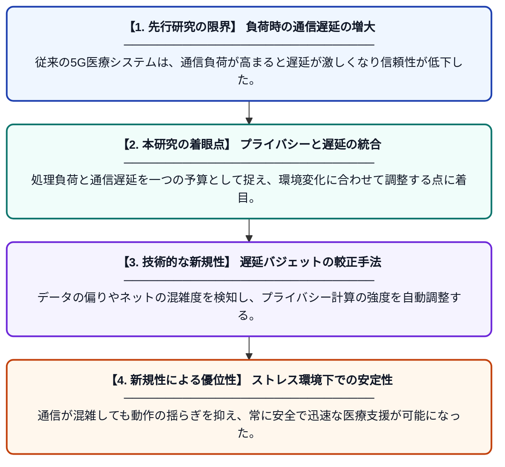

# 信頼できる差分プライバシー：臨床意思決定支援における遅延バジェットの較正

**Original Title**: *Trustworthy Differential Privacy: Calibrating Latency Budgets in Clinical Decision Support*

> **💡 一言要約**: 医療5Gの遅延とプライバシーを同時に最適化

| 項目 | 内容 |
|---|---|
| **著者** | R Mohamed, S Mohamed |
| **アラートキーワード** | differential privacy |
| **PDF** | [https://www.researchgate.net/profile/Safa-Mohamed-16/publication/417191981_Trustworthy_Differential_Privacy_Calibrating_Latency_Budgets_in_Clinical_Decision_Support/links/6ae4821d3e7df118bc6938cd/Trustworthy-Differential-Privacy-Calibrating-Latency-Budgets-in-Clinical-Decision-Support.pdf](https://www.researchgate.net/profile/Safa-Mohamed-16/publication/417191981_Trustworthy_Differential_Privacy_Calibrating_Latency_Budgets_in_Clinical_Decision_Support/links/6ae4821d3e7df118bc6938cd/Trustworthy-Differential-Privacy-Calibrating-Latency-Budgets-in-Clinical-Decision-Support.pdf) |
| **原文リンク** | [https://www.researchgate.net/profile/Safa-Mohamed-16/publication/417191981_Trustworthy_Differential_Privacy_Calibrating_Latency_Budgets_in_Clinical_Decision_Support/links/6ae4821d3e7df118bc6938cd/Trustworthy-Differential-Privacy-Calibrating-Latency-Budgets-in-Clinical-Decision-Support.pdf](https://www.researchgate.net/profile/Safa-Mohamed-16/publication/417191981_Trustworthy_Differential_Privacy_Calibrating_Latency_Budgets_in_Clinical_Decision_Support/links/6ae4821d3e7df118bc6938cd/Trustworthy-Differential-Privacy-Calibrating-Latency-Budgets-in-Clinical-Decision-Support.pdf) |
| **PDF版要約** | [README.pdf](./README.pdf) |

---

## 📊 新規性の図解（先行研究との違いと本研究のブレークスルー）

## 📝 要約

5GネットワークとeHealthにおいて不可欠な超高信頼・低遅延通信は、環境変化や負荷増大によるデータの不安定化が課題です。本研究は、臨床意思決定支援において差分プライバシーと遅延時間を統合的に管理・較正する手法を提案し、システムの信頼性を向上させました。

## ❓ どんな問題に取り組んだか

5Gを活用した医療システムでは、通信負荷の増大やデータの分布変化によって「ジッター（遅延の揺らぎ）」が発生し、信頼性が著しく低下します。既存のプライバシー保護手法は特定の条件下では有効ですが、実環境のストレス下では処理が追いつかず、迅速な臨床判断を妨げるという課題があります。

## ✨ 何が新しい？何がすごい？（新規性）

本研究は、差分プライバシーを単なるデータ隠蔽技術としてではなく、遅延時間を制御するための「バジェット（予算）」として捉え直し、動的に較正する手法を開発しました。先行研究では困難だった「プライバシー保護の計算負荷」と「通信のリアルタイム性」の高度な両立を、分布シフトに対する耐性を持たせる形で実現しています。これにより、ネットワークが不安定な状況下でも、一貫して信頼性の高い臨床支援データの提供が可能となりました。

## 🎓 大学1年生向けの解説

遠隔医療などでは、情報の「プライバシーを守ること」と「一瞬の遅れも許さないこと」のどちらも非常に重要です。しかし、情報を暗号化したり複雑な処理をしたりすると、どうしてもデータのやり取りに時間がかかってしまいます。この研究は、その処理時間を賢くやりくりするルールを作ることで、どんなに通信が混み合っても、安全で素早い情報の受け渡しができるようにしました。これにより、お医者さんが緊急時に迷わず正しい判断を下せるようになります。
