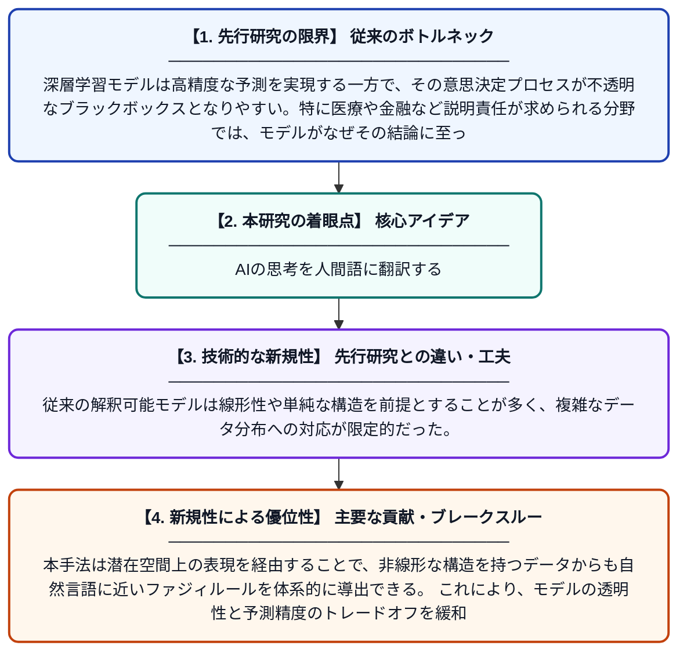

# 潜在埋め込みからの透明なルール帰納のための生成的ファジィアプローチ

**Original Title**: *A Generative-Fuzzy Approach for Transparent Rule Induction from Latent Embeddings*

> **💡 一言要約**: AIの思考を人間語に翻訳する

| 項目 | 内容 |
|---|---|
| **著者** | M Grazioso, E Degara, MS Nobile, A Tangherloni |
| **掲載誌** | IJCNN / WCCI 2026 2026 |
| **アラートキーワード** | manifold learning |
| **PDF** | [http://linklings.s3.amazonaws.com/organizations/WCCI/wcci2026/submissions/stype114/Qce2o-ijcnn_pap4312s2.pdf](http://linklings.s3.amazonaws.com/organizations/WCCI/wcci2026/submissions/stype114/Qce2o-ijcnn_pap4312s2.pdf) |
| **原文リンク** | [http://linklings.s3.amazonaws.com/organizations/WCCI/wcci2026/submissions/stype114/Qce2o-ijcnn_pap4312s2.pdf](http://linklings.s3.amazonaws.com/organizations/WCCI/wcci2026/submissions/stype114/Qce2o-ijcnn_pap4312s2.pdf) |
| **PDF版要約** | [README.pdf](./README.pdf) |

---

## 📊 新規性の図解（先行研究との違いと本研究のブレークスルー）

## 📝 要約

本論文は、複雑な非線形データ分布を人間が読める形のファジィルール集合に変換する手法を提案している。生成的多様体学習と言語的帰納を組み合わせることで、データの構造を段階的に抽出し、解釈可能なルールへと変換するワークフローを構築している。これにより、高度なAIモデルの「ブラックボックス」問題を解消し、説明可能な人工知能（XAI）の実現に貢献する。

## ❓ どんな問題に取り組んだか

深層学習モデルは高精度な予測を実現する一方で、その意思決定プロセスが不透明なブラックボックスとなりやすい。特に医療や金融など説明責任が求められる分野では、モデルがなぜその結論に至ったかを人間が理解できる形で説明することが困難であった。複雑な非線形データ分布から、解釈可能なルールを自動的に抽出する汎用的な手法が求められていた。

## ✨ 何が新しい？何がすごい？（新規性）

本研究の新規性は、生成モデルによる多様体学習とファジィ論理に基づく言語的ルール帰納を組み合わせた点にある。従来の解釈可能モデルは線形性や単純な構造を前提とすることが多く、複雑なデータ分布への対応が限定的だった。本手法は潜在空間上の表現を経由することで、非線形な構造を持つデータからも自然言語に近いファジィルールを体系的に導出できる。これにより、モデルの透明性と予測精度のトレードオフを緩和する新たなアプローチを提示している。

## 🎓 大学1年生向けの解説

AIは多くの場合、なぜその答えを出したかを説明できない「ブラックボックス」です。この研究では、AIが内部で学んだ知識を『もし〇〇ならば△△』という人間に分かりやすいルールの形に自動変換する方法を開発しました。具体的には、データの隠れた構造を生成モデルで捉え、それをファジィ論理という「曖昧さを扱える論理」を使ってルール化します。これにより、医師や専門家がAIの判断根拠を理解・確認できるようになり、より安全で信頼できるAIの実現につながります。
