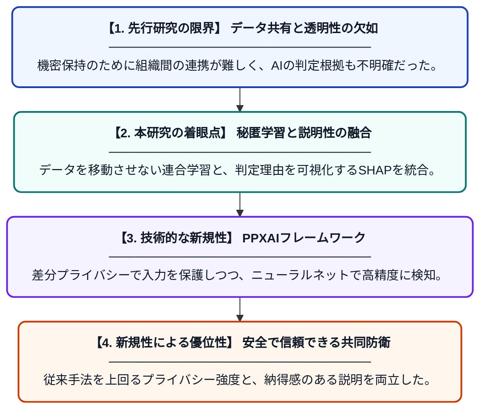

# 私立大学の侵入検知に向けたプライバシー保護と説明可能性を両立した連合学習：デザインサイエンス研究とベンチマーク評価

**Original Title**: *Privacy-Preserving Explainable Federated Learning for Intrusion Detection in Private Universities: A Design Science Study with Controlled Benchmark Evaluation*

> **💡 一言要約**: プライバシーと説明性を両立した大学向け侵入検知

| 項目 | 内容 |
|---|---|
| **著者** | M Cosmas, KL Mlelwa |
| **掲載誌** | International Journal of Research and Innovation in … 2026 |
| **アラートキーワード** | differential privacy |
| **原文リンク** | [https://econpapers.repec.org/article/bjfjournl/v_3a11_3ay_3a2026_3ai_3a9_3ap_3a2067-2075.htm](https://econpapers.repec.org/article/bjfjournl/v_3a11_3ay_3a2026_3ai_3a9_3ap_3a2067-2075.htm) |
| **PDF版要約** | [README.pdf](./README.pdf) |

---

## 📊 新規性の図解（先行研究との違いと本研究のブレークスルー）

## 📝 要約

私立大学のネットワークセキュリティを向上させるため、データの機密性を守りつつ攻撃の根拠を説明できる「PPXAI」フレームワークを提案しました。連合学習、差分プライバシー、SHAPによる説明手法を組み合わせることで、従来のモデルよりも安全かつ透明性の高い侵入検知を実現しています。

## ❓ どんな問題に取り組んだか

サイバー攻撃の巧妙化に対し、組織間でデータを共有して対策を練る必要がありますが、機密情報の漏洩リスクが壁となっていました。また、AIによる検知プロセスが「ブラックボックス」であるため、なぜ攻撃と判断されたのかが分からず、運用の信頼性が低いという課題がありました。

## ✨ 何が新しい？何がすごい？（新規性）

連合学習（FL）と差分プライバシー（DP）を統合し、さらにSHAPを用いた説明可能AIを組み込んだ点が最大の特徴です。単一組織での学習や、単なるプライバシー保護手法と異なり、データの秘匿性を担保しながら、検知精度と「なぜ攻撃か」という根拠の提示を同時に達成する設計を構築し、その有効性を実証しました。

## 🎓 大学1年生向けの解説

複数の大学が、自分たちの持っている大切なデータを外に出さずに、お互いの「攻撃を受けた経験」だけを共有して賢いセキュリティAIを作る仕組みを開発しました。このAIは賢いだけでなく、「なぜこれが怪しいと思ったのか」を人間が分かるように理由を教えてくれます。プライバシーを守るための特殊な加工をしても、ちゃんと攻撃を見抜ける高い性能を持っているのがこの研究のすごいところです。
