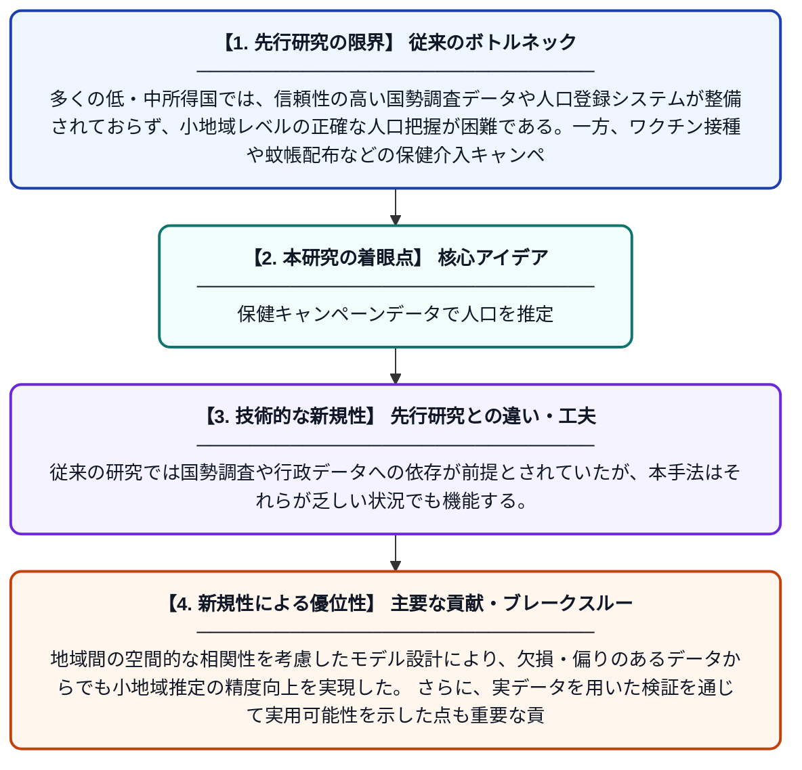

# 部分的なカバレッジを持つ保健介入キャンペーンデータを用いた国家小地域人口推定モデリング

**Original Title**: *National Small-Area Population Estimation Modelling Using Partial Coverage Health Intervention Campaign Data*

> **💡 一言要約**: 保健キャンペーンデータで人口を推定

| 項目 | 内容 |
|---|---|
| **著者** | CC Nnanatu, A Gadiaga, OO Oke, AN Lazar, AJ Tatem |
| **掲載誌** | 2026 |
| **アラートキーワード** | Bayesian hierarchical ... |
| **PDF** | [https://www.preprints.org/frontend/manuscript/0b6d283b4d59093f6c26bba8efde8ec2/download_pub](https://www.preprints.org/frontend/manuscript/0b6d283b4d59093f6c26bba8efde8ec2/download_pub) |
| **原文リンク** | [https://www.preprints.org/frontend/manuscript/0b6d283b4d59093f6c26bba8efde8ec2/download_pub](https://www.preprints.org/frontend/manuscript/0b6d283b4d59093f6c26bba8efde8ec2/download_pub) |
| **PDF版要約** | [README.pdf](./README.pdf) |

---

## 📊 新規性の図解（先行研究との違いと本研究のブレークスルー）

## 📝 要約

本論文では、保健介入キャンペーン（ワクチン接種や蚊帳配布など）で収集された部分的なデータを活用して、小地域レベルの信頼性ある人口推定値を算出するためのベイズ階層モデルを開発した。データクリーニング戦略を組み合わせることで、不完全なカバレッジデータから生じる偏りを補正する手法を提案している。この手法は、国勢調査データが乏しい途上国における人口把握の新たなアプローチとして期待される。

## ❓ どんな問題に取り組んだか

多くの低・中所得国では、信頼性の高い国勢調査データや人口登録システムが整備されておらず、小地域レベルの正確な人口把握が困難である。一方、ワクチン接種や蚊帳配布などの保健介入キャンペーンでは大量の受益者データが収集されるが、カバレッジが部分的で偏りがあるため、そのまま人口推定に利用することは難しかった。

## ✨ 何が新しい？何がすごい？（新規性）

本研究の新規性は、部分的なカバレッジしか持たない保健キャンペーンデータを人口推定に活用するためのベイズ階層モデルと統合的データクリーニング戦略を組み合わせた点にある。従来の研究では国勢調査や行政データへの依存が前提とされていたが、本手法はそれらが乏しい状況でも機能する。地域間の空間的な相関性を考慮したモデル設計により、欠損・偏りのあるデータからでも小地域推定の精度向上を実現した。さらに、実データを用いた検証を通じて実用可能性を示した点も重要な貢献である。

## 🎓 大学1年生向けの解説

人口を正確に知ることは、病院や学校をどこに作るかを決めるためにとても重要です。しかし、アフリカなどの途上国では全員を数える国勢調査が難しい地域も多くあります。そこでこの研究では、ワクチンを配ったり蚊帳を届けたりする保健活動で集めたデータを使って、その地域に何人住んでいるかを推定する新しい計算方法を作りました。データが一部しかなくても統計的なモデルで補正することで、かなり正確な人口の見積もりができることを示しています。これにより、データが少ない国でも政策立案に役立てられる人口情報が得られるようになります。
