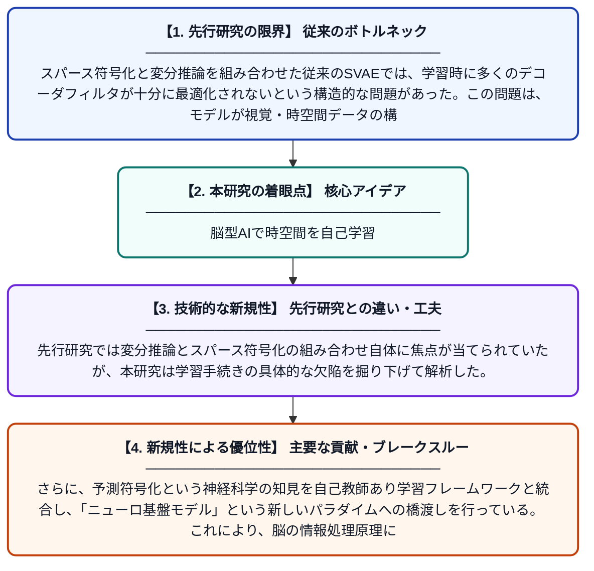

# 自己教師あり学習による時空間構造の推定：予測符号化からニューロ基盤モデルへ

**Original Title**: *Inferring Spatiotemporal Structure Through Self-Supervised Learning: From Predictive Coding to Neuro Foundation Models*

> **💡 一言要約**: 脳型AIで時空間を自己学習

| 項目 | 内容 |
|---|---|
| **著者** | L Jiang |
| **掲載誌** | 2026 |
| **アラートキーワード** | sparse coding |
| **原文リンク** | [https://search.proquest.com/openview/b8bf6835bfde9aff60f1bc973a8146ca/1?pq-origsite=gscholar&cbl=18750&diss=y](https://search.proquest.com/openview/b8bf6835bfde9aff60f1bc973a8146ca/1?pq-origsite=gscholar&cbl=18750&diss=y) |
| **PDF版要約** | [README.pdf](./README.pdf) |

---

## 📊 新規性の図解（先行研究との違いと本研究のブレークスルー）

## 📝 要約

本論文は、スパース符号化と変分推論を組み合わせたモデル「SVAE（スパース符号化変分オートエンコーダ）」を研究し、その学習手続きの問題点を分析する。従来のSVAE学習では多くのデコーダフィルタが十分に最適化されないという課題を明らかにし、改善手法を提案する。自己教師あり学習を通じて、脳の予測符号化メカニズムにインスパイアされたニューロ基盤モデルの構築を目指す研究である。

## ❓ どんな問題に取り組んだか

スパース符号化と変分推論を組み合わせた従来のSVAEでは、学習時に多くのデコーダフィルタが十分に最適化されないという構造的な問題があった。この問題は、モデルが視覚・時空間データの構造を正確に表現する能力を制限しており、生物の神経回路が行うような効率的な情報表現の実現を妨げていた。

## ✨ 何が新しい？何がすごい？（新規性）

本研究は、SVAEのデコーダフィルタが学習不足になるメカニズムを明確に特定し、その改善手法を提案している点が新しい。先行研究では変分推論とスパース符号化の組み合わせ自体に焦点が当てられていたが、本研究は学習手続きの具体的な欠陥を掘り下げて解析した。さらに、予測符号化という神経科学の知見を自己教師あり学習フレームワークと統合し、「ニューロ基盤モデル」という新しいパラダイムへの橋渡しを行っている。これにより、脳の情報処理原理に基づいた汎用的なAIモデル構築に貢献する。

## 🎓 大学1年生向けの解説

私たちの脳は、目で見たものや耳で聞いたものを効率よく圧縮して記憶しています。この研究では、脳の仕組みを真似たコンピュータモデル（SVAE）を作り、そのモデルがうまく学習できない問題を発見・改善しました。自己教師あり学習とは、ラベルなしデータからコンピュータ自身がパターンを学ぶ方法です。この技術を使うことで、脳のような賢いAIを作ることを目指しています。まるでAIに「自分で考える力」を与えようとしている研究です。
