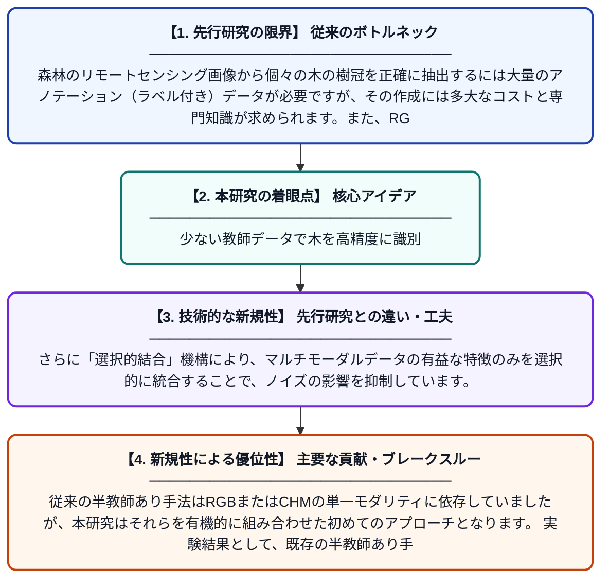

# クラウン垂直意味蒸留と選択的結合による半教師あり多モーダル個別樹冠抽出

**Original Title**: *Semi-Supervised Multi-Modal Individual Tree Crown Delineation Via Crown Vertical Semantic Distillation With Selective Coupling*

> **💡 一言要約**: 少ない教師データで木を高精度に識別

| 項目 | 内容 |
|---|---|
| **著者** | X Zhong, Z Song, X Fan, T Tjahjadi, Q Ye, L Fu |
| **掲載誌** | IEEE Journal of Selected Topics in Applied Earth Observations and Remote Sensing 2026 |
| **アラートキーワード** | Semi supervise |
| **PDF** | [https://ieeexplore.ieee.org/iel8/4609443/4609444/11626033.pdf](https://ieeexplore.ieee.org/iel8/4609443/4609444/11626033.pdf) |
| **原文リンク** | [https://ieeexplore.ieee.org/iel8/4609443/4609444/11626033.pdf](https://ieeexplore.ieee.org/iel8/4609443/4609444/11626033.pdf) |
| **PDF版要約** | [README.pdf](./README.pdf) |

---

## 📊 新規性の図解（先行研究との違いと本研究のブレークスルー）

## 📝 要約

本論文は、航空・衛星リモートセンシング画像から個々の木の樹冠を自動的に分割・抽出するための新しい半教師あり学習フレームワークを提案しています。RGB画像と樹冠高モデル（CHM）を組み合わせたマルチモーダルアプローチに、クラウン垂直意味蒸留と選択的結合という独自の手法を導入しました。これにより、ラベルなしデータを効果的に活用しながら、既存の半教師あり手法や他のマルチモーダル手法を上回る精度を実現しています。

## ❓ どんな問題に取り組んだか

森林のリモートセンシング画像から個々の木の樹冠を正確に抽出するには大量のアノテーション（ラベル付き）データが必要ですが、その作成には多大なコストと専門知識が求められます。また、RGB画像のみやCHMのみを用いた単一モーダルの手法では、情報量に限界があり複雑な森林環境での精度向上に課題がありました。

## ✨ 何が新しい？何がすごい？（新規性）

本研究の最大の新規性は、「クラウン垂直意味蒸留」という手法により、樹冠の3次元的な垂直構造情報をCHMからRGBベースのモデルへと効果的に転移させる点です。さらに「選択的結合」機構により、マルチモーダルデータの有益な特徴のみを選択的に統合することで、ノイズの影響を抑制しています。従来の半教師あり手法はRGBまたはCHMの単一モダリティに依存していましたが、本研究はそれらを有機的に組み合わせた初めてのアプローチとなります。実験結果として、既存の半教師あり手法および他のマルチモーダル手法を上回る性能を示しています。

## 🎓 大学1年生向けの解説

森の上から撮影した写真を見て、一本一本の木がどこにあるかをコンピューターに自動で教えたいのですが、そのためには「これが木です」という正解データをたくさん用意する必要があります。この研究では、正解データが少なくても高精度に木を見つけられる賢い方法を開発しました。普通のカラー写真（RGB）だけでなく、木の高さを表す特別なデータ（CHM）も一緒に使うことで、より多くの情報を活用します。さらに「意味蒸留」という技術で、木の高さ情報の知識をカラー画像の分析に役立てるという工夫もしています。これにより、少ない手間で森林の状態を正確に把握でき、環境保護や林業管理に役立てることができます。
