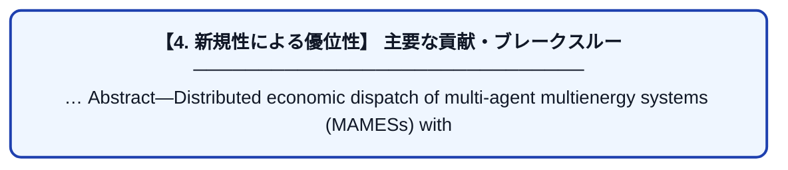

# Secure Distributed Low-Carbon Dispatch of Multi-Agent Multi-Energy Systems with Energy Hubs

| 項目 | 内容 |
|---|---|
| **著者** | YF Xie, XC Jia, T Lv, ZP Yuan, XB Chi |
| **掲載誌** | IEEE Transactions on Smart Grid 2026 |
| **アラートキーワード** | multi agent |
| **原文リンク** | [https://ieeexplore.ieee.org/abstract/document/11769622/](https://ieeexplore.ieee.org/abstract/document/11769622/) |
| **PDF版要約** | [README.pdf](./README.pdf) |

---

## 📊 新規性の図解（先行研究との違いと本研究のブレークスルー）

## 📝 要約

… Abstract—Distributed economic dispatch of multi-agent multienergy systems (MAMESs) with energy hubs (EHs) is challenged by tight … , a fully distributed iterative framework is constructed by integrating a multi-agent consensus algorithm with the …
