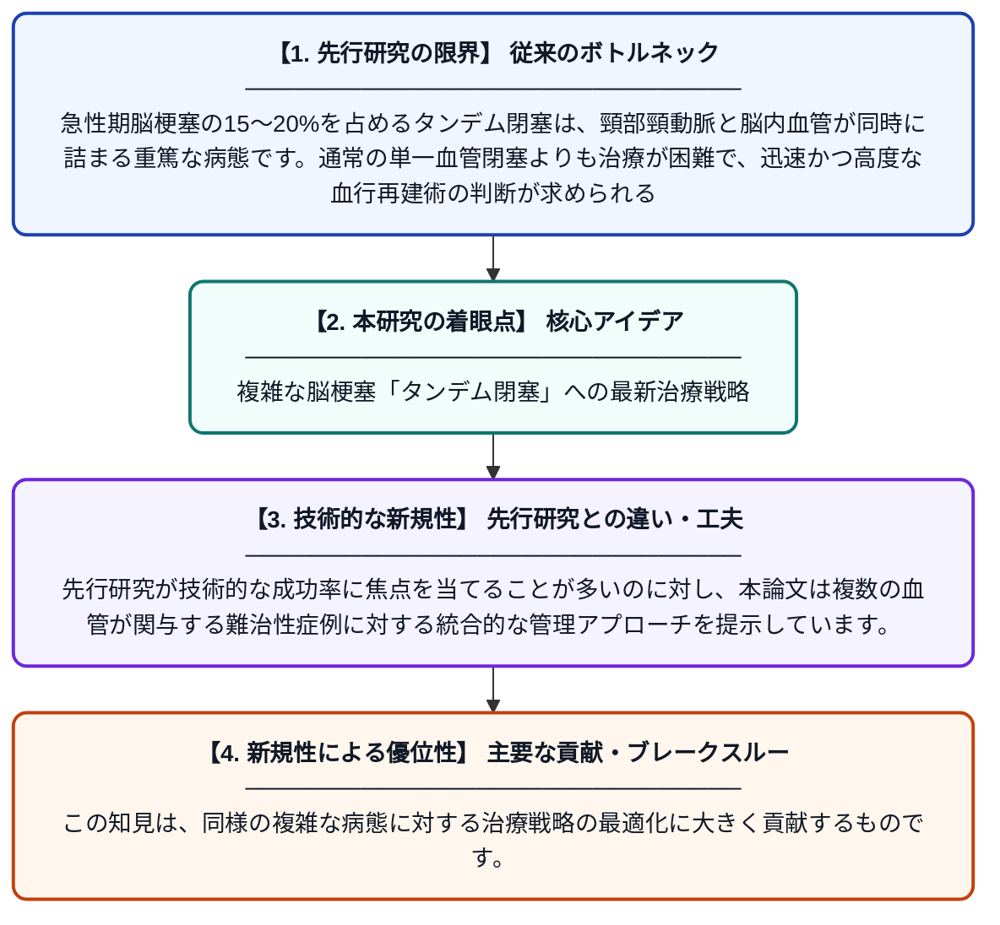

# 複雑な急性期脳梗塞病変に対する現代的アプローチ：症例報告

**Original Title**: *CONTEMPORARY APPROACH OF COMPLEX ACUTE ISCHEMIC STROKE LESIONS: A CASE REPORT WITH*

> **💡 一言要約**: 複雑な脳梗塞「タンデム閉塞」への最新治療戦略

| 項目 | 内容 |
|---|---|
| **著者** | A Aracki-Trenkić, S Ristić, F Petrović, M Novaković… |
| **アラートキーワード** | ICA |
| **PDF** | [https://publisher.medfak.ni.ac.rs/AMM_1/accepted/2027-1-broj/celi_radovi/19.Aleksandra%20Aracki%20Trenkic.pdf](https://publisher.medfak.ni.ac.rs/AMM_1/accepted/2027-1-broj/celi_radovi/19.Aleksandra%20Aracki%20Trenkic.pdf) |
| **原文リンク** | [https://publisher.medfak.ni.ac.rs/AMM_1/accepted/2027-1-broj/celi_radovi/19.Aleksandra%20Aracki%20Trenkic.pdf](https://publisher.medfak.ni.ac.rs/AMM_1/accepted/2027-1-broj/celi_radovi/19.Aleksandra%20Aracki%20Trenkic.pdf) |
| **PDF版要約** | [README.pdf](./README.pdf) |

---

## 📊 新規性の図解（先行研究との違いと本研究のブレークスルー）

## 📝 要約

本論文は、頸動脈と脳内血管が同時に閉塞する「タンデム閉塞」を伴う急性期脳梗塞の症例を報告したものです。複雑な血管閉塞に対する最新の治療介入と、その臨床的対応策について詳しく考察しています。

## ❓ どんな問題に取り組んだか

急性期脳梗塞の15〜20%を占めるタンデム閉塞は、頸部頸動脈と脳内血管が同時に詰まる重篤な病態です。通常の単一血管閉塞よりも治療が困難で、迅速かつ高度な血行再建術の判断が求められる点が課題となっています。

## ✨ 何が新しい？何がすごい？（新規性）

本研究は、複雑な血栓除去術における臨床的な意思決定プロセスを実例に基づいて体系化しました。先行研究が技術的な成功率に焦点を当てることが多いのに対し、本論文は複数の血管が関与する難治性症例に対する統合的な管理アプローチを提示しています。この知見は、同様の複雑な病態に対する治療戦略の最適化に大きく貢献するものです。

## 🎓 大学1年生向けの解説

脳梗塞は脳の血管が詰まる病気ですが、中には首の血管と脳の中の血管が同時に詰まってしまう非常に危険なタイプがあります。これを「タンデム閉塞」と呼び、治療がとても難しいことが知られています。この論文では、そのような重症の患者さんに対して、医師がどのように血管の詰まりを取り除き、命を救おうとしたかを詳しく解説しています。医学の最前線でどのように難病に立ち向かっているかを知ることができる貴重な資料です。
