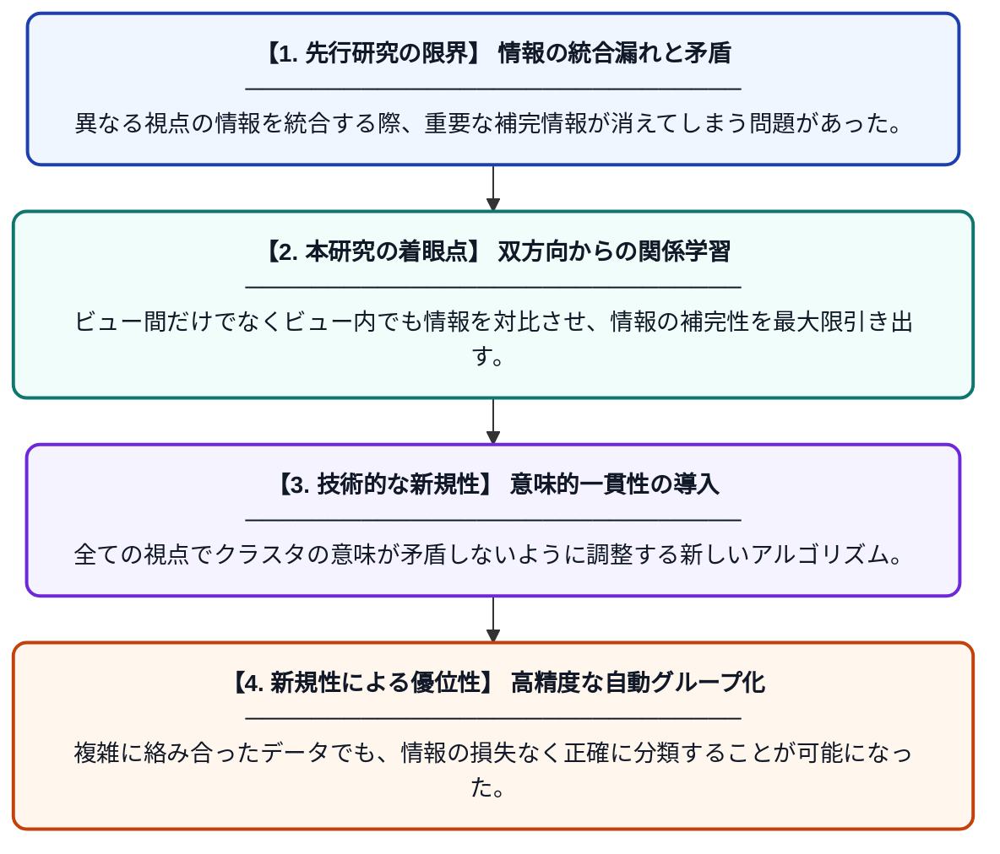

# マルチビュークラスタリングのための意味的一貫性を備えた双方向対照学習

**Original Title**: *Bidirectional contrastive learning with semantic consistency for multi-view clustering*

> **💡 一言要約**: 双方向の対照学習でデータの「本質」を捉える

| 項目 | 内容 |
|---|---|
| **著者** | S Wang, K Shen, B Cai, P Dai, GF Lu |
| **掲載誌** | Signal Processing 2026 |
| **アラートキーワード** | representation learning |
| **原文リンク** | [https://www.sciencedirect.com/science/article/pii/S0165168426005335](https://www.sciencedirect.com/science/article/pii/S0165168426005335) |
| **PDF版要約** | [README.pdf](./README.pdf) |

---

## 📊 新規性の図解（先行研究との違いと本研究のブレークスルー）

## 📝 要約

複数の視点（ビュー）から得られるデータを効果的に統合するため、双方向の対照学習と意味的な一貫性を導入した新しい深層学習手法を提案しています。異なるビュー間の補完的な情報を最大限に活用し、低次元の共有表現を学習することで、高精度なクラスタリングを実現しました。

## ❓ どんな問題に取り組んだか

従来のマルチビュークラスタリングでは、異なる視点間の複雑な非線形関係を十分に捉えきれず、情報の損失が生じる課題がありました。また、各ビューが持つ個別の特徴と共通の特徴をバランスよく統合し、意味的に矛盾のないグループ分けを行うことが困難でした。

## ✨ 何が新しい？何がすごい？（新規性）

本研究は双方向対照学習を導入し、ビュー間とビュー内の両方でデータの相関を最適化する仕組みを構築しました。さらに、潜在空間においてクラスタの意味的一貫性を保証する制約を加えることで、データの背後にある論理構造をより正確に抽出できるようにしています。これにより、先行研究よりも非線形なデータ構造に対して頑健な表現学習が可能になりました。

## 🎓 大学1年生向けの解説

例えば「果物」を判定する時、色（視点1）と形（視点2）の両方の情報を使えばより正確に判定できます。この論文は、そうした複数の視点からの情報を、双方向から照らし合わせることで「同じ種類である」という本質を賢く見つけ出すAI技術を開発しました。バラバラに見える情報でも、意味が矛盾しないようにつなぎ合わせることで、複雑なデータを正確にグループ分けできるようになります。
