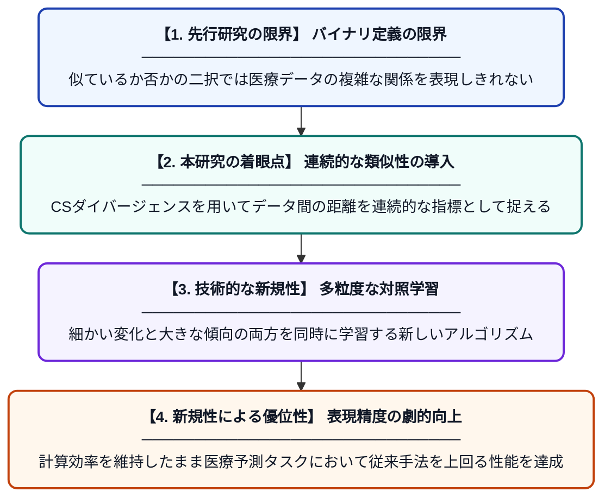

# 多粒度コーシー・シュワルツ対照学習による電子健康記録（EHR）の表現学習

**Original Title**: *EHR Representation Learning with Multi-Granularity Cauchy-Schwarz Contrastive Learning*

> **💡 一言要約**: 連続的指標でEHRの隠れた関係を解き明かす

| 項目 | 内容 |
|---|---|
| **著者** | K Oei, S Yu, Q Liu, R Jenssen |
| **掲載誌** | Northern Lights Deep Learning Conference 2027 |
| **アラートキーワード** | representation learning |
| **PDF** | [https://openreview.net/pdf?id=KwAxfFeXAf](https://openreview.net/pdf?id=KwAxfFeXAf) |
| **原文リンク** | [https://openreview.net/pdf?id=KwAxfFeXAf](https://openreview.net/pdf?id=KwAxfFeXAf) |
| **PDF版要約** | [README.pdf](./README.pdf) |

---

## 📊 新規性の図解（先行研究との違いと本研究のブレークスルー）

## 📝 要約

電子健康記録（EHR）の時系列データを効率的に学習するため、従来のバイナリな対照学習に代わり、連続的な指標とコーシー・シュワルツ（CS）ダイバージェンスを用いた新しい表現学習手法を提案しています。この手法により、患者データの複雑な関係性を複数の粒度で精密に捉えることが可能になりました。

## ❓ どんな問題に取り組んだか

従来のEHR表現学習は、データ同士が「似ているか否か」という0か1かのバイナリな関係定義に依存しており、医療データ特有の複雑な階層性や連続的な類似性を十分に表現できていませんでした。また、大規模なデータセットにおいて計算効率と表現の精細さを両立させることが困難でした。

## ✨ 何が新しい？何がすごい？（新規性）

本研究の核心は、対照学習におけるペア割り当てをバイナリから連続的な値へと拡張し、コーシー・シュワルツ（CS）ダイバージェンスを導入した点にあります。さらに、データの粒度（マクロな傾向からミクロな変化まで）を考慮した「多粒度」な学習枠組みを構築しました。これにより、先行研究では見落とされていた微妙なデータ間の相関を効率的に抽出することに成功しています。

## 🎓 大学1年生向けの解説

病院に蓄積された患者さんの診察データを、AIが理解しやすい「特徴」として抽出する技術の研究です。これまでは「このデータとあのデータは似ている」といった単純な分け方をしていましたが、この研究では「どれくらい、どの細かさで似ているか」を数学的な新しい方法で計算するようにしました。その結果、AIは患者さんの健康状態の微妙な変化や共通点をより正確に見つけることができるようになりました。
