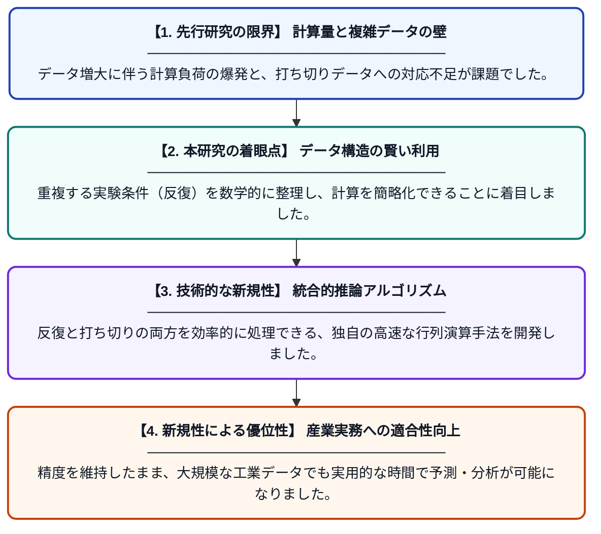

# 大規模な反復データおよび打ち切りデータを対象とした産業研究向け効率的ガウス過程モデリング

**Original Title**: *Efficient Gaussian Process Modeling for Large Replicated and Censored Data in Industrial Research*

> **💡 一言要約**: 複雑な工業データを高速・正確に処理する新ガウス過程

| 項目 | 内容 |
|---|---|
| **著者** | Y Zhang, EL Kang, S Li |
| **掲載誌** | arXiv preprint arXiv:2611.05684 2026 |
| **アラートキーワード** | gaussian process |
| **PDF** | [https://arxiv.org/pdf/2611.05684](https://arxiv.org/pdf/2611.05684) |
| **原文リンク** | [https://arxiv.org/pdf/2611.05684](https://arxiv.org/pdf/2611.05684) |
| **PDF版要約** | [README.pdf](./README.pdf) |

---

## 📊 新規性の図解（先行研究との違いと本研究のブレークスルー）

## 📝 要約

産業界の実験で頻発する、同一条件下での繰り返し測定（反復データ）や測定限界による値の欠落（打ち切りデータ）を含む大規模なデータセットに対して、効率的なガウス過程回帰モデルを提案しています。計算コストを劇的に抑えつつ、現実の複雑なデータ構造に適合する高度な統計的推論手法を確立しました。

## ❓ どんな問題に取り組んだか

標準的なガウス過程はデータ数が増えると計算負荷が指数関数的に増大するため、大規模データの処理が困難です。特に産業現場でよく見られる「同じ実験の繰り返し」や「一定値以上/以下が測定不能な打ち切りデータ」が混在する場合、従来の手法では計算効率と予測精度の両立が非常に困難でした。

## ✨ 何が新しい？何がすごい？（新規性）

本研究は、反復データと打ち切りデータの持つ統計的特性を統合的に扱う新しい計算フレームワークを開発しました。従来の汎用的な近似手法とは異なり、工業プロセス特有のデータ構造を利用して行列演算を効率化することで、大規模データにおいても精度を損なうことなく計算時間を大幅に短縮しています。これにより、従来は計算不可能だった規模の実験データに対して、ガウス過程による不確実性評価を伴う高度な予測が可能になりました。

## 🎓 大学1年生向けの解説

ガウス過程という計算手法は、データの傾向を予測するのが得意ですが、計算がとても重いという弱点があります。特に、同じ条件で何度も測ったデータや、測定器の限界で正確な数字がわからないデータがたくさんあると、コンピューターがパンクしてしまいます。この研究は、そんな「扱いにくいデータ」の癖を見抜いて計算を工夫することで、巨大なデータでもあっという間に処理できるようにしたものです。これにより、工場の製品テストのような現実の難しい場面でも、最新のAI技術が使いやすくなります。
