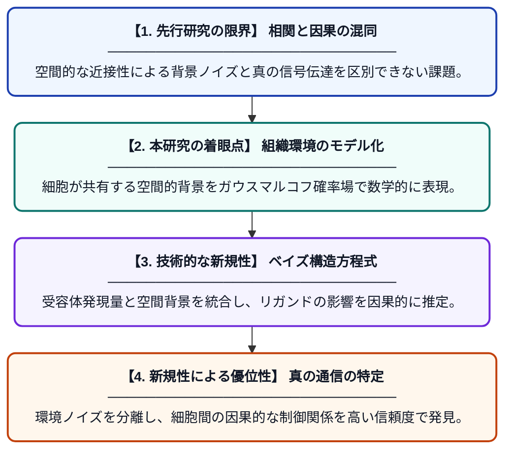

# CASPER：空間解像度を備えた因果的な細胞間コミュニケーションの発見

**Original Title**: *CASPER: Discovering Spatially Resolved Causal Cell-Cell Communications*

> **💡 一言要約**: 細胞間の「会話」を因果関係で解き明かす

| 項目 | 内容 |
|---|---|
| **著者** | Y Ni |
| **掲載誌** | arXiv preprint arXiv:2611.31108 2026 |
| **アラートキーワード** | Markov random"  fields |
| **PDF** | [https://arxiv.org/pdf/2611.31108](https://arxiv.org/pdf/2611.31108) |
| **原文リンク** | [https://arxiv.org/pdf/2611.31108](https://arxiv.org/pdf/2611.31108) |
| **PDF版要約** | [README.pdf](./README.pdf) |

---

## 📊 新規性の図解（先行研究との違いと本研究のブレークスルー）

## 📝 要約

CASPERは、細胞間の相互作用を因果的に推定するための新しいベイズ構造方程式モデルです。受容体の発現量を調整し、ガウスマルコフ確率場を用いて組織全体の共有環境をモデル化することで、リガンドへの曝露が標的遺伝子に与える影響を正確に特定します。

## ❓ どんな問題に取り組んだか

細胞同士が単に近くに存在することで生じる「背景の類似性」と、リガンド（信号分子）を通じた「真の相互作用」を区別することは非常に困難でした。これまでの解析手法では、組織環境によるノイズが原因で、相関関係と因果関係を混同してしまう課題がありました。

## ✨ 何が新しい？何がすごい？（新規性）

CASPERは、ベイズ統計を用いて受容体の発現状態と組織の背景環境を同時に考慮する構造方程式を導入しました。特に、ガウスマルコフ確率場（GMRF）を用いることで、空間的に近接する細胞が共有する共通の微小環境を効果的に制御できる点が画期的です。これにより、どのような条件下でリガンドの影響が因果として識別可能になるかを理論的に示し、従来の相関ベースの解析よりも高い精度を実現しました。

## 🎓 大学1年生向けの解説

細胞たちはリガンドという手紙を送ってお互いに連絡を取り合っていますが、隣同士の細胞が似ているのは「本当に手紙をやり取りしているから」なのか、それとも単に「同じ環境に住んでいるから」なのかを判断するのは難しい問題でした。この研究で作られた『CASPER』という手法は、高度な数学（統計学）を使って、周りの環境の影響をうまく取り除くことで、細胞同士の本物の会話だけを見つけ出すことができます。これにより、どの細胞がどの細胞に命令を出しているのかが、これまで以上にハッキリわかるようになります。
