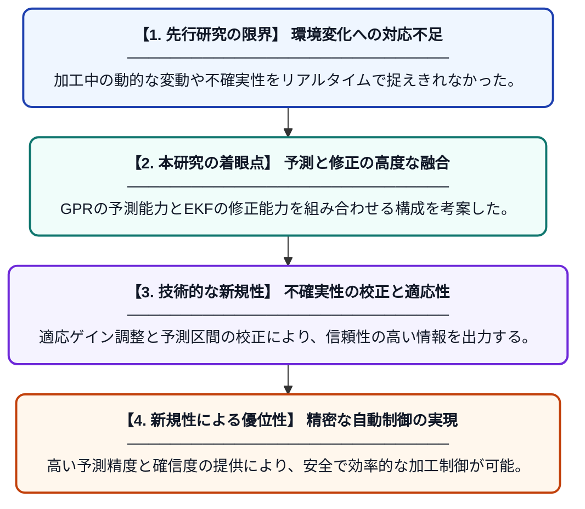

# 実験的クローズドループ検証による、不確実性が校正された切削抵抗予測のための適応的GPR–EKF

**Original Title**: *Adaptive GPR–EKF for uncertainty-calibrated cutting-force prediction with experimental closed-loop validation*

> **💡 一言要約**: AIと高度なフィルタで切削抵抗を精密に予測

| 項目 | 内容 |
|---|---|
| **著者** | W Fu, W Yang, Q Li, W Tian, H Xue |
| **掲載誌** | Measurement 2026 |
| **アラートキーワード** | gaussian process |
| **原文リンク** | [https://www.sciencedirect.com/science/article/pii/S0263224126034822](https://www.sciencedirect.com/science/article/pii/S0263224126034822) |
| **PDF版要約** | [README.pdf](./README.pdf) |

---

## 📊 新規性の図解（先行研究との違いと本研究のブレークスルー）

## 📝 要約

ガウス過程回帰（GPR）と拡張カルマンフィルタ（EKF）を組み合わせ、切削抵抗をリアルタイムで高精度に予測するフレームワークを提案しました。適応的なゲイン調整と予測区間の校正により、加工中の不確実性を考慮した信頼性の高い予測を実現しています。

## ❓ どんな問題に取り組んだか

金属加工中の切削抵抗予測において、加工環境の変動や突発的な不確実性にリアルタイムで対応することが困難でした。また、予測値がどの程度信頼できるかという「確信度」を定量的に評価し、制御に反映させる仕組みも不足していました。

## ✨ 何が新しい？何がすごい？（新規性）

自己回帰GPRによる1ステップ予測とEKFによる再帰的修正を統合し、さらに適応的なゲイン調整機能を導入した点が画期的です。単なる点予測にとどまらず、予測の不確実性を校正（キャリブレーション）して提示する機能を備えています。先行研究と比較して、動的な加工条件下での頑健性が高く、実験的なクローズドループ検証によってその実用性が証明されました。

## 🎓 大学1年生向けの解説

金属を削る工作機械が、削る時にかかる「力」を自分で予想しながら動くための新しい計算方法の研究です。AIの一種であるガウス過程回帰と、誤差を修正するのが得意なカルマンフィルタという2つの数学的手法を合体させました。これにより、次にどれくらいの力がかかるかを当てるだけでなく、「今の予想はこれくらい自信がある」という情報も出せるようになります。この技術を使えば、機械が壊れないように自分で力を加減する、賢いものづくりが可能になります。
