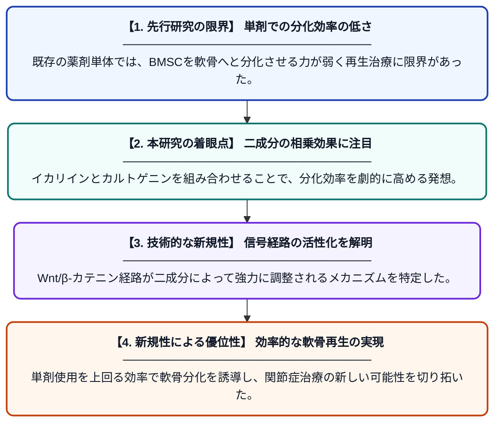

# イカリインとカルトゲニンの併用による、Wnt/β-カテニン経路を介した骨髄由来間葉系幹細胞の軟骨分化誘導メカニズムの研究

**Original Title**: *Icariin and kartogenin: research on the mechanism of combined intervention on chondrogenic differentiation of BMSCs via the Wnt/β‑catenin pathway*

> **💡 一言要約**: ICAとKGNの最強タッグで軟骨再生を加速

| 項目 | 内容 |
|---|---|
| **著者** | W Xiang, X Yu, R Chen, H Feng, L Zhang, C Song… |
| **掲載誌** | Molecular biology reports 2026 |
| **アラートキーワード** | ICA |
| **原文リンク** | [https://pubmed.ncbi.nlm.nih.gov/42961674/](https://pubmed.ncbi.nlm.nih.gov/42961674/) |
| **PDF版要約** | [README.pdf](./README.pdf) |

---

## 📊 新規性の図解（先行研究との違いと本研究のブレークスルー）

## 📝 要約

本研究は、骨髄由来間葉系幹細胞（BMSC）を軟骨細胞へと分化させるプロセスにおいて、イカリイン（ICA）とカルトゲニン（KGN）を併用した際のメカニズムを解明しました。解析の結果、これら二つの成分がWnt/β-カテニン経路を介して相乗的に作用し、変形性関節症の治療において高いポテンシャルを持つことが示されました。

## ❓ どんな問題に取り組んだか

変形性関節症の治療において、骨髄由来間葉系幹細胞を効率的に軟骨細胞へと分化させることが不可欠ですが、単一の薬剤では分化効率が低く、治療効果が不十分であるという課題がありました。また、分化を促進するための具体的な分子メカニズムの特定も求められていました。

## ✨ 何が新しい？何がすごい？（新規性）

本研究の新規性は、伝統的な成分であるイカリインと合成化合物のカルトゲニンを組み合わせることで、単独使用よりも劇的に軟骨分化を促進できることを示した点にあります。特に、OAチップデータを用いた網羅的な解析を通じて、Wnt/β-カテニン経路がこれらの相乗効果を支える主要な役割を果たしていることを具体的に突き止めました。これにより、異なる機序を持つ薬剤を併用する新しい治療プロトコルの理論的根拠を確立しました。

## 🎓 大学1年生向けの解説

関節が痛くなる病気（変形性関節症）を治すために、私たちの体の中にある「何にでもなれる細胞」を「軟骨」へと変える研究です。植物由来の成分「イカリイン」と新しい薬「カルトゲニン」を混ぜて使うと、細胞の中にあるスイッチ（Wnt経路）が効率よく入り、軟骨がスムーズに作られることがわかりました。いわば、細胞を育てるための「最高の肥料の組み合わせ」を発見したようなもので、将来の関節再生への大きな一歩となります。
