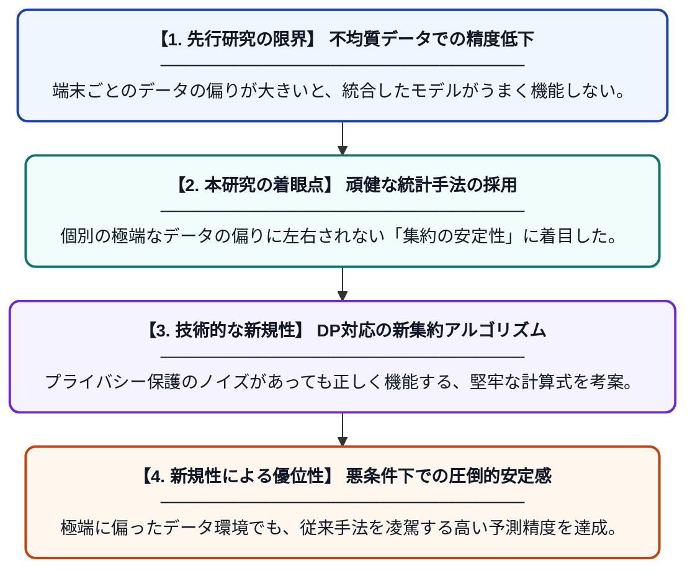

# 高度に不均質なデータに対する堅牢な連合学習集約手法

**Original Title**: *Robust federated learning aggregation for highly heterogeneous data*

> **💡 一言要約**: 多様なデータでも崩れない、最強の連合学習集約術

| 項目 | 内容 |
|---|---|
| **著者** | JH Bae, B Park, PPB Gusmão, M Kim, M Kim |
| **掲載誌** | Cluster Computing 2026 |
| **アラートキーワード** | Federated Learning |
| **原文リンク** | [https://link.springer.com/article/10.1007/s10586-026-06716-3](https://link.springer.com/article/10.1007/s10586-026-06716-3) |
| **PDF版要約** | [README.pdf](./README.pdf) |

---

## 📊 新規性の図解（先行研究との違いと本研究のブレークスルー）

## 📝 要約

各端末のデータ分布が大きく異なる環境下でも、安定して学習を進めることができる新しい連合学習の集約アルゴリズムを提案しています。特にプライバシー保護のためのノイズを加えた状態でも、精度を落とさずにモデルを統合できる堅牢性を備えています。

## ❓ どんな問題に取り組んだか

連合学習において、各端末が持つデータの傾向がバラバラ（不均質）な場合、モデルの統合がうまくいかず精度が著しく低下する課題がありました。また、プライバシー保護のためにノイズを付加する既存手法では、この不均質性の影響がさらに増幅され、学習が不安定になるというジレンマも存在しました。

## ✨ 何が新しい？何がすごい？（新規性）

本研究は、データの偏りやノイズによる悪影響を統計的に排除する、新しい「堅牢な集約アルゴリズム」を開発した点が画期的です。従来の差分プライバシー連合学習（DP-FL）が抱えていた、プライバシー保護と学習精度のトレードオフを、集約プロセスの工夫によって大幅に改善しました。これにより、実世界の極端に偏ったデータ環境でも、安定して高性能なモデルを構築することが可能になります。

## 🎓 大学1年生向けの解説

「連合学習」とは、みんなのスマホにあるデータを一箇所に集めずに、プライバシーを守りながら賢いAIを作る技術です。しかし、人によってスマホの使い方が全く違うと、意見がバラバラすぎてAIが混乱してしまうという弱点がありました。この研究は、みんなの意見がどれだけ違っていても、そこから「本当に正しい情報」だけを上手に抜き取ってまとめる新しい計算方法を見つけました。これによって、個人の秘密を守りつつ、どんなに個性豊かなデータからでも賢いAIを作れるようになります。
