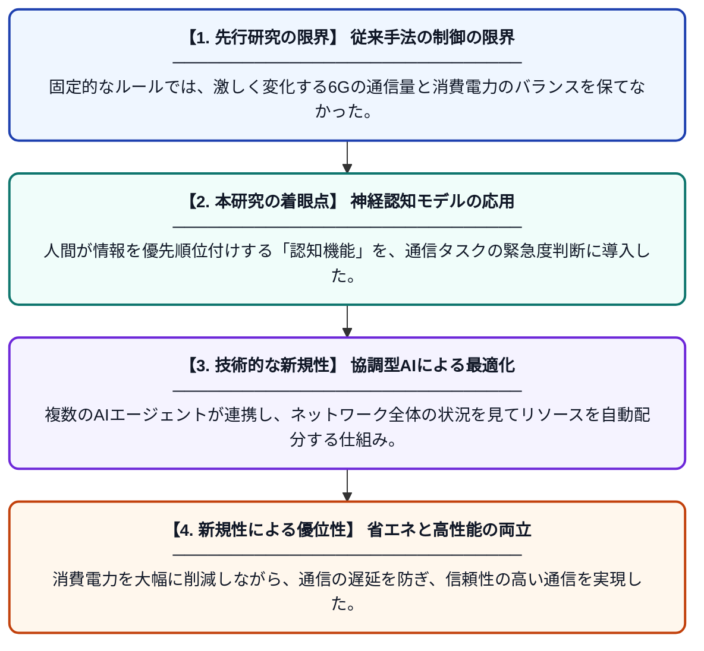

# マルチエージェント強化学習を用いた持続可能な6Gエッジコンピューティングのためのニューロ・コグニティブ・アウェアな省電力リソース割り当て

**Original Title**: *Neuro-Cognitive-Aware Energy-Efficient Resource Allocation for Sustainable 6 G Edge Computing Using Multi-Agent Reinforcement Learning*

> **💡 一言要約**: 脳の認知機能を応用し、6Gの省電力化と低遅延を両立

| 項目 | 内容 |
|---|---|
| **著者** | T Ramesh, LH Medida, S Sajithra, TCJ Jeaunita |
| **掲載誌** | Sustainable Computing: Informatics … 2026 |
| **アラートキーワード** | multi agent |
| **原文リンク** | [https://www.sciencedirect.com/science/article/pii/S2210537926002192](https://www.sciencedirect.com/science/article/pii/S2210537926002192) |
| **PDF版要約** | [README.pdf](./README.pdf) |

---

## 📊 新規性の図解（先行研究との違いと本研究のブレークスルー）

## 📝 要約

本研究は、6Gエッジコンピューティングにおいて、神経科学的な知見（ニューロ・コグニティブ）を取り入れたマルチエージェント強化学習（MARL）により、エネルギー効率の高いリソース割り当てを実現する手法を提案しています。ネットワークから得られる緊急度を考慮することで、高いサービス信頼性と低遅延を両立し、持続可能な通信インフラの構築に寄与します。

## ❓ どんな問題に取り組んだか

次世代の6Gネットワークでは、膨大なデータを処理するために消費電力の増大が深刻な課題となっています。また、リアルタイム性が求められるアプリケーションにおいて、通信の遅延を抑えながら限られたリソースを効率的に配分し、サービスの信頼性を維持することは非常に困難です。

## ✨ 何が新しい？何がすごい？（新規性）

従来の強化学習に「ニューロ・コグニティブ・アウェア（神経認知認識）」の概念を導入し、タスクの緊急度を人間の認知プロセスのように重み付けする点が画期的です。複数のエージェントが協調して動作するMARLを採用することで、複雑なネットワーク環境下でも動的なリソース調整を可能にしました。これにより、先行研究と比較して、エネルギー効率の向上と遅延管理の最適化を同時に高い水準で達成しています。

## 🎓 大学1年生向けの解説

スマートフォンや自動運転などで使われる「6G」という未来の通信では、たくさんの情報を一瞬で処理するために膨大な電気を使います。この研究では、人間の脳が「大事な情報」を素早く見分ける仕組みをヒントにして、AIにネットワークの電気をどう使うか判断させました。その結果、電気を節約しながら、情報の遅れも少なくすることに成功しました。地球に優しく、かつインターネットがサクサク動く未来を作るための技術です。
