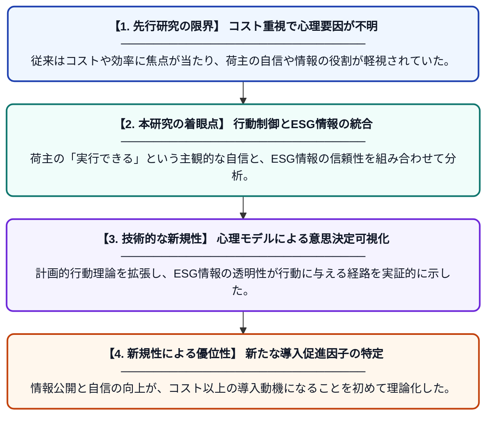

# グリーン物流導入の再考：荷主による物流業者選定における知覚された行動制御とESG情報の役割

**Original Title**: *Reconsidering green logistics adoption: the role of perceived behavioral control and ESG information in shippers' selection of logistics service providers*

> **💡 一言要約**: ESG情報と「自信」がグリーン物流の鍵

| 項目 | 内容 |
|---|---|
| **著者** | YC Chen, TC Lirn, KD Ye, CK Sung |
| **掲載誌** | The International Journal of Logistics … 2026 |
| **アラートキーワード** | logistics |
| **原文リンク** | [https://www.emerald.com/ijlm/article-abstract/doi/10.1108/IJLM-02-2026-0203/1406207](https://www.emerald.com/ijlm/article-abstract/doi/10.1108/IJLM-02-2026-0203/1406207) |
| **PDF版要約** | [README.pdf](./README.pdf) |

---

## 📊 新規性の図解（先行研究との違いと本研究のブレークスルー）

## 📝 要約

荷主が環境に配慮した物流業者を選ぶ際、「自分たちには変える力がある」という心理的自信（知覚された行動制御）と、業者のESG情報がどのように意思決定を左右するかを分析した研究です。単なるコスト比較ではなく、情報の透明性と意思決定者の主観がグリーン物流の普及に不可欠であることを明らかにしています。

## ❓ どんな問題に取り組んだか

多くの企業が環境負荷の低減を掲げているものの、実際にグリーン物流業者への切り替えが進まないという課題があります。特に、荷主が「自社の判断で物流を変えられる」という確信をどの程度持っているか、また提供されるESG情報が選択にどう関わるかという内面的なメカニズムが十分に解明されていませんでした。

## ✨ 何が新しい？何がすごい？（新規性）

従来の物流研究で主流だったコストや効率性の分析に留まらず、心理学的要素である「知覚された行動制御」を導入の決定要因として組み込んだ点が画期的です。また、環境指標だけでなく社会・ガバナンスを含むESG情報全体が、荷主の選択行動に与える影響を実証的にモデル化しました。これにより、制度的な規制だけでなく、情報の質と企業の主体性がグリーン化を加速させることを理論的に証明しました。

## 🎓 大学1年生向けの解説

「環境に優しい配送」を選びたくても、お金や手間のことを考えると「本当に自分たちにできるかな？」と不安になる会社は多いです。この研究は、その「自分たちならできる」という自信と、相手の会社がどれだけ環境や社会に貢献しているかというデータ（ESG情報）が、決断を強く後押しすることを突き止めました。つまり、やる気だけでなく、しっかりした情報と自分たちの意思が揃うことが、地球に優しい物流への第一歩になるという内容です。
