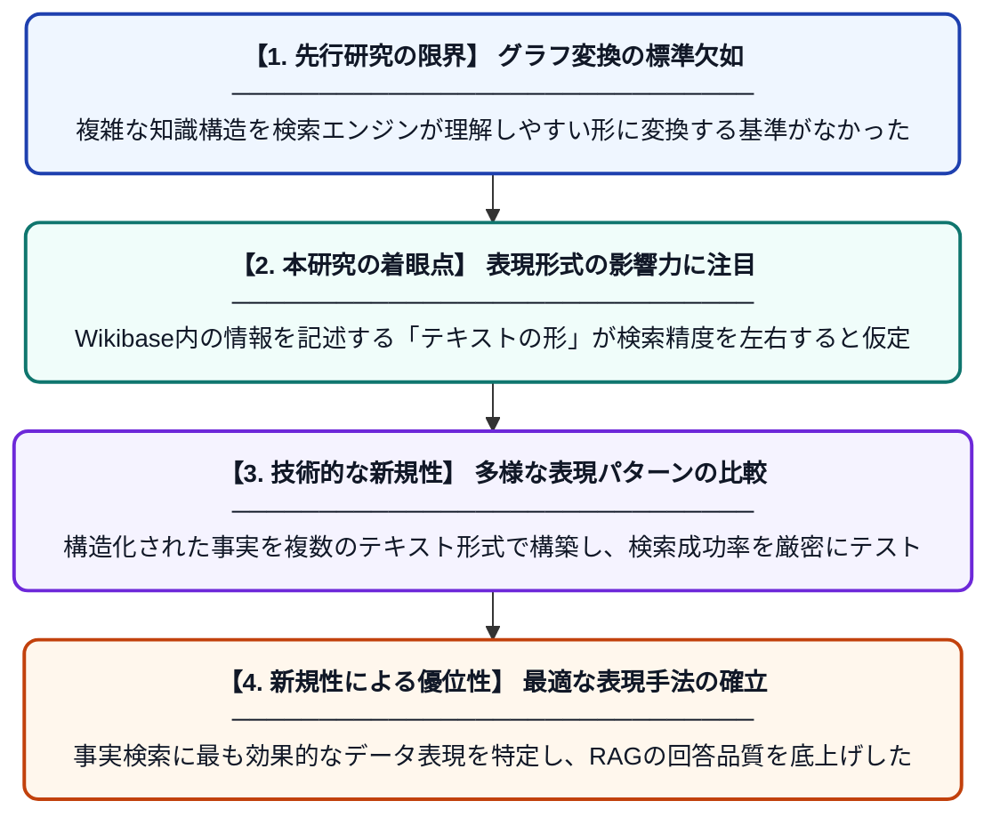

# Wikibaseを用いたRAGにおけるコンテンツ表現が検索性能に与える影響の評価

**Original Title**: *Evaluating the Impact of Content Representations on Retrieval Performance in Wikibase RAG*

> **💡 一言要約**: Wikibase RAGの検索精度を最大化するデータ表現を特定

| 項目 | 内容 |
|---|---|
| **著者** | K Bailly, L Rossenova, I Blümel |
| **掲載誌** | 2026 |
| **アラートキーワード** | graph rag |
| **PDF** | [https://ceur-ws.org/Vol-4312/short38.pdf](https://ceur-ws.org/Vol-4312/short38.pdf) |
| **Git リポジトリ** | [https://gitlab.com/nfdi4culture/wikibase4research](https://gitlab.com/nfdi4culture/wikibase4research) |
| **原文リンク** | [https://ceur-ws.org/Vol-4312/short38.pdf](https://ceur-ws.org/Vol-4312/short38.pdf) |
| **PDF版要約** | [README.pdf](./README.pdf) |

---

## 📊 新規性の図解（先行研究との違いと本研究のブレークスルー）

## 📝 要約

知識グラフ（Wikibase）を活用したRAGシステムにおいて、データの表現方法が検索精度に与える影響を定量的に評価した論文です。情報をどのようなテキスト形式で保持し検索に用いるべきか、複数の表現パターンを比較することで、事実検索に最適な構成を明らかにしています。

## ❓ どんな問題に取り組んだか

知識グラフの構造化データをRAGで利用する際、それをどのようなテキスト形式に変換して検索エンジンにインデックスすべきかが不明確でした。不適切な表現を選択すると、生成AIが回答に必要な事実を正しく検索できず、システム全体の精度が低下するという課題がありました。

## ✨ 何が新しい？何がすごい？（新規性）

従来のRAG研究が主に非構造化文書を対象としていたのに対し、本研究はWikibase特有の構造データに焦点を当て、複数のテキスト変換手法を体系的に比較しました。エンティティや関係性の記述順序や詳細度が検索性能に与える影響を詳細に分析し、グラフベースRAGのための最適なシリアライズ手法を提案しています。これにより、知識グラフの利点を最大限に引き出すRAGパイプラインの設計指針を確立しました。

## 🎓 大学1年生向けの解説

AIが質問に答えるとき、辞書のような知識データを読み取って回答を作ります。この論文は、その知識データを「AIにとって最も探しやすく理解しやすい書き方」にするにはどうすれば良いかを調べたものです。知識を並べる順番や書き方を工夫するだけで、AIが正しい答えを見つけ出す能力が大きく変わることを示しました。より賢いAIアシスタントを作るための、重要な工夫について書かれています。
