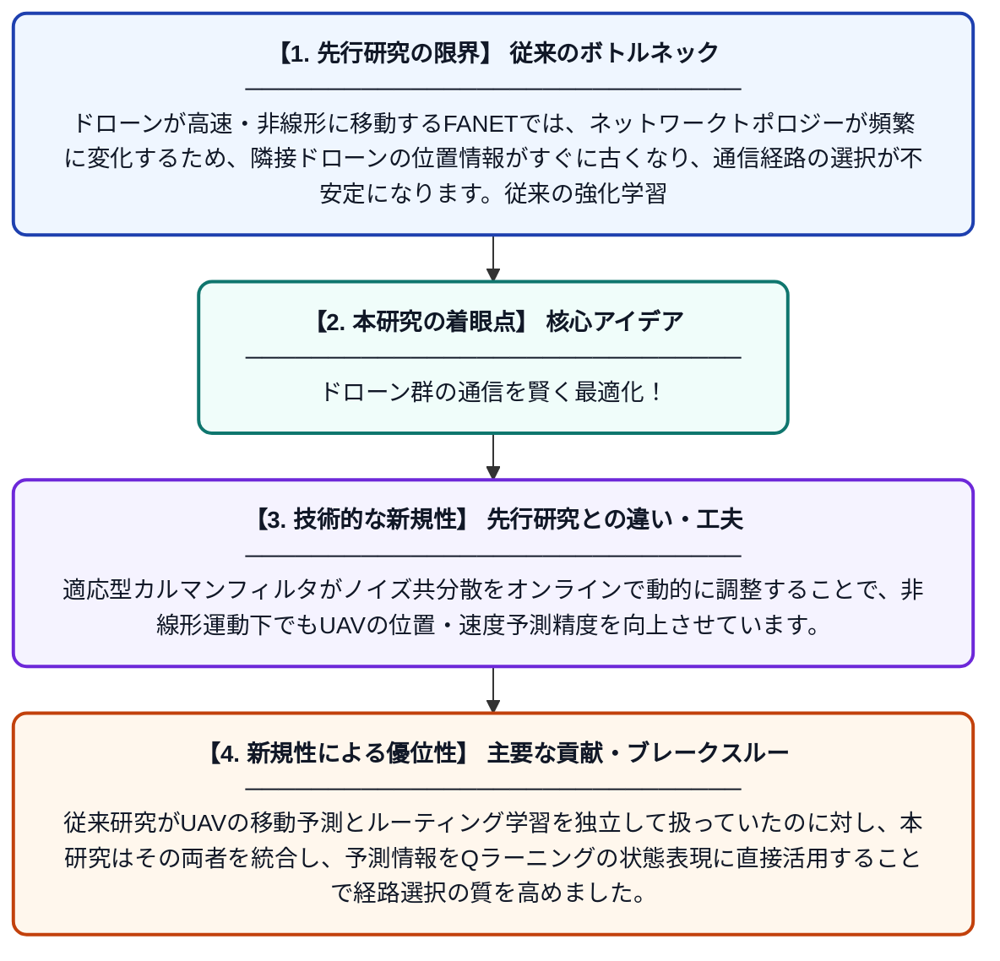

# KFQR: カルマンフィルタ支援型協調Qラーニングルーティングプロトコル（FANETs向け）

**Original Title**: *KFQR: A Kalman Filter-Assisted Cooperative Q-Learning Routing Protocol for FANETs*

> **💡 一言要約**: ドローン群の通信を賢く最適化！

| 項目 | 内容 |
|---|---|
| **著者** | Z Wu, X Jun, X Luo, Y He |
| **掲載誌** | Computer Networks 2026 |
| **アラートキーワード** | kalman filter |
| **原文リンク** | [https://www.sciencedirect.com/science/article/pii/S1389128626006274](https://www.sciencedirect.com/science/article/pii/S1389128626006274) |
| **PDF版要約** | [README.pdf](./README.pdf) |

---

## 📊 新規性の図解（先行研究との違いと本研究のブレークスルー）

## 📝 要約

本論文は、ドローン（UAV）の群れで構成されるネットワーク（FANET）において、通信経路の選択を改善するための新しいルーティングプロトコルを提案しています。一定加速度運動モデルに基づいた適応型カルマンフィルタを用いてUAVの位置・速度をリアルタイムで予測し、隣接ノードの情報の陳腐化問題を軽減します。さらに協調Qラーニングを組み合わせることで、動的かつ不安定なネットワーク環境でも安定した通信経路を自律的に確立します。

## ❓ どんな問題に取り組んだか

ドローンが高速・非線形に移動するFANETでは、ネットワークトポロジーが頻繁に変化するため、隣接ドローンの位置情報がすぐに古くなり、通信経路の選択が不安定になります。従来の強化学習ベースのルーティングでは、この「情報の陳腐化」に対処できず、パケット損失や遅延が増大するという課題がありました。

## ✨ 何が新しい？何がすごい？（新規性）

本研究の最大の新規性は、カルマンフィルタと協調Qラーニングを融合させた点です。適応型カルマンフィルタがノイズ共分散をオンラインで動的に調整することで、非線形運動下でもUAVの位置・速度予測精度を向上させています。従来研究がUAVの移動予測とルーティング学習を独立して扱っていたのに対し、本研究はその両者を統合し、予測情報をQラーニングの状態表現に直接活用することで経路選択の質を高めました。これにより、既存手法と比較して通信遅延・パケット損失率の大幅な改善を実現しています。

## 🎓 大学1年生向けの解説

ドローンを複数飛ばして互いに通信させる「ドローンネットワーク」では、ドローンが常に動き回るため、誰と通信すればよいかを素早く判断するのが難しいです。この研究では「カルマンフィルタ」という数学的な予測技術を使い、次の瞬間にドローンがどこにいるかを計算して、通信相手を先読みして決める仕組みを作りました。さらに、AIの一種である「強化学習（Qラーニング）」を組み合わせることで、ドローンたちが協力しながら最適な通信ルートを自動的に学習できます。この二つの技術を組み合わせることで、ドローンが激しく動いても安定して通信できるようになりました。
