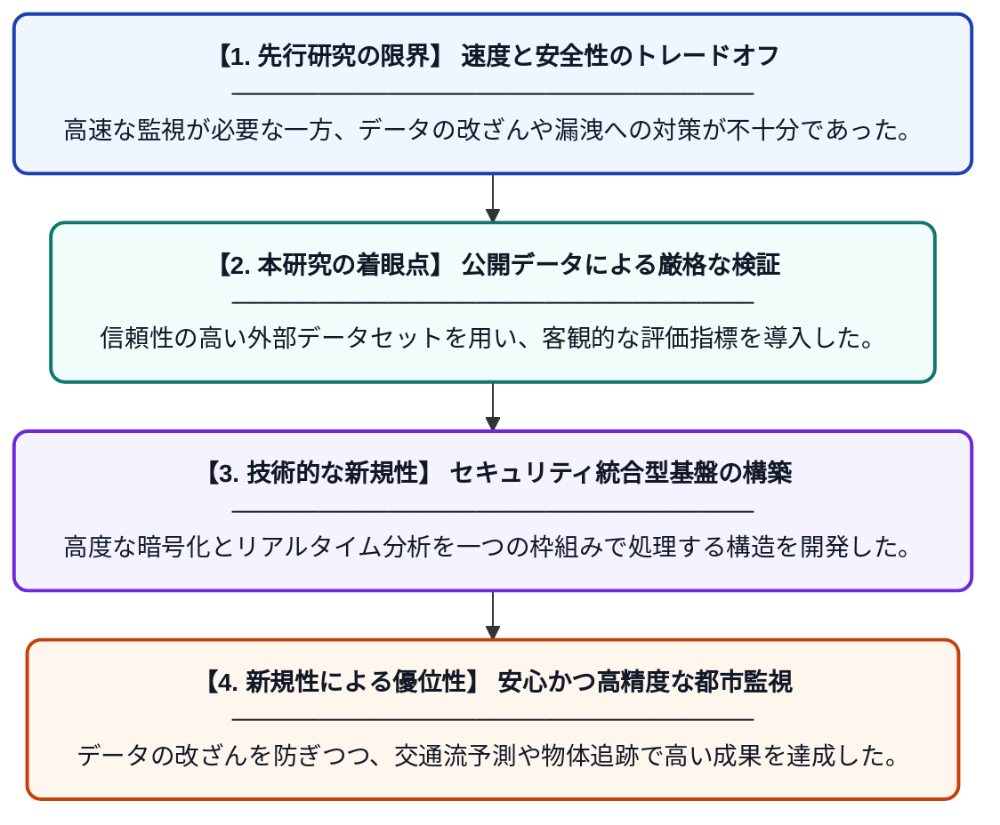

# スマートシティ監視システムのための安全なリアルタイムデータ処理フレームワーク

**Original Title**: *Secure Real-Time Data Processing Frameworks for Smart City Surveillance Systems*

> **💡 一言要約**: 安全で高速な都市監視を実現する新フレームワーク

| 項目 | 内容 |
|---|---|
| **著者** | R Williams, JH Lee, A Al-Farsi, OK Oladele, M Santos |
| **アラートキーワード** | Multi Camera Tracking |
| **PDF** | [https://www.researchgate.net/profile/Oluwaseyi-Oladele-3/publication/416908992_Secure_Real-Time_Data_Processing_Frameworks_for_Smart_City_Surveillance_Systems/links/6adfd4c41ad3626457d6b1b9/Secure-Real-Time-Data-Processing-Frameworks-for-Smart-City-Surveillance-Systems.pdf](https://www.researchgate.net/profile/Oluwaseyi-Oladele-3/publication/416908992_Secure_Real-Time_Data_Processing_Frameworks_for_Smart_City_Surveillance_Systems/links/6adfd4c41ad3626457d6b1b9/Secure-Real-Time-Data-Processing-Frameworks-for-Smart-City-Surveillance-Systems.pdf) |
| **原文リンク** | [https://www.researchgate.net/profile/Oluwaseyi-Oladele-3/publication/416908992_Secure_Real-Time_Data_Processing_Frameworks_for_Smart_City_Surveillance_Systems/links/6adfd4c41ad3626457d6b1b9/Secure-Real-Time-Data-Processing-Frameworks-for-Smart-City-Surveillance-Systems.pdf](https://www.researchgate.net/profile/Oluwaseyi-Oladele-3/publication/416908992_Secure_Real-Time_Data_Processing_Frameworks_for_Smart_City_Surveillance_Systems/links/6adfd4c41ad3626457d6b1b9/Secure-Real-Time-Data-Processing-Frameworks-for-Smart-City-Surveillance-Systems.pdf) |
| **PDF版要約** | [README.pdf](./README.pdf) |

---

## 📊 新規性の図解（先行研究との違いと本研究のブレークスルー）

## 📝 要約

本研究は、スマートシティにおける交通流や監視カメラの映像をリアルタイムかつ安全に処理するための新しいフレームワークを提案しています。公開されている交通データセットや複数カメラの追跡ベンチマークを用いて、その精度とセキュリティ性能を客観的に評価しています。

## ❓ どんな問題に取り組んだか

スマートシティの監視システムでは、膨大なデータをリアルタイムで処理する必要がありますが、データの改ざんやプライバシー保護といったセキュリティ面の課題が残っています。また、既存の手法では高度な検出や追跡を安全かつ高速に両立させることが困難でした。

## ✨ 何が新しい？何がすごい？（新規性）

この研究は、交通流予測（METR-LA、PeMS-BAY）と物体追跡のベンチマークを組み合わせ、外部から検証可能な形式で評価の信頼性を高めた点が特徴です。単なるリアルタイム処理の高速化だけでなく、セキュリティ機能を統合した包括的なアーキテクチャを提案しています。先行研究と比較して、多地点カメラの連携における整合性とデータの正当性を同時に担保している点が画期的です。

## 🎓 大学1年生向けの解説

街中に設置されたカメラやセンサーの情報を、ハッカーに盗まれたり改ざんされたりすることなく、一瞬で分析する仕組みを開発した研究です。例えば、渋滞の予測や不審者の発見を、プライバシーを守りながら自動で行えるようになります。実際の交通データを使ってテストされており、将来の「賢い街（スマートシティ）」を支える重要な技術です。
