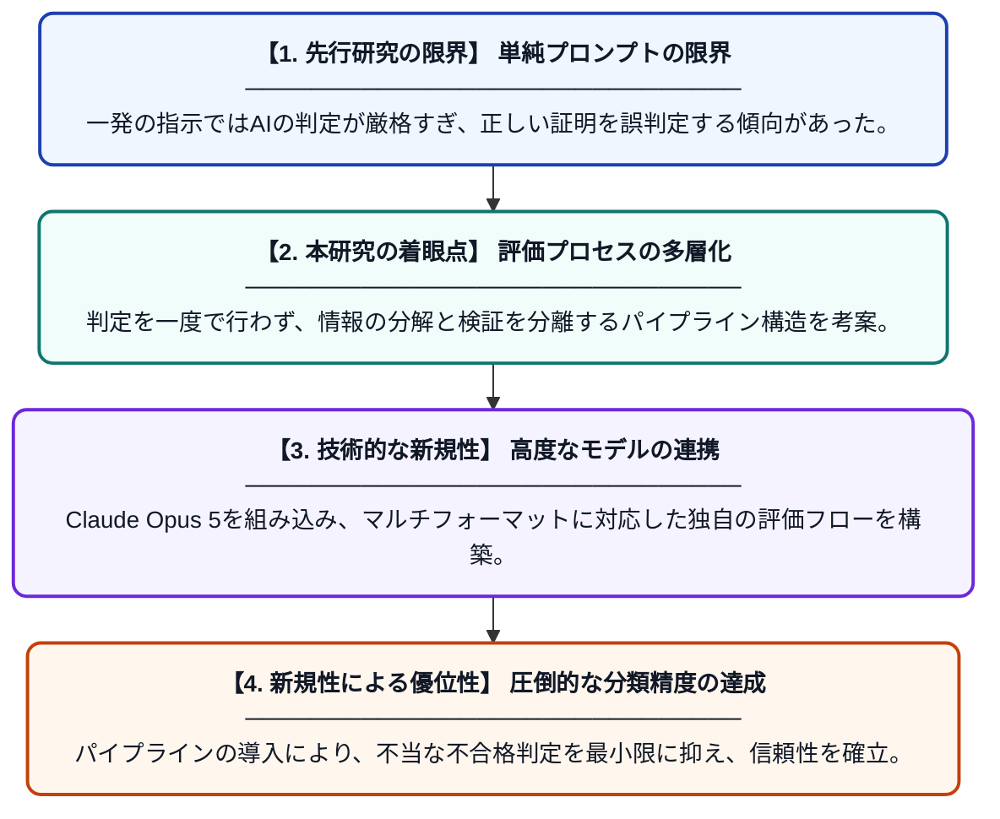

# ラマヌジャン・チャレンジの結果：マルチフォーマット証明のためのAI支援評価パイプライン

**Original Title**: *Ramanujan Challenge Results: AI-Assisted Evaluation Pipeline for Multi-Format Proofs*

> **💡 一言要約**: AIによる数学証明の自動評価を劇的に高精度化

| 項目 | 内容 |
|---|---|
| **著者** | A Sorani, A Narayanan, M Shalyt, T Monderer… |
| **掲載誌** | arXiv preprint arXiv … 2026 |
| **アラートキーワード** | one shot |
| **PDF** | [https://arxiv.org/pdf/2610.40551](https://arxiv.org/pdf/2610.40551) |
| **原文リンク** | [https://arxiv.org/pdf/2610.40551](https://arxiv.org/pdf/2610.40551) |
| **PDF版要約** | [README.pdf](./README.pdf) |

---

## 📊 新規性の図解（先行研究との違いと本研究のブレークスルー）

## 📝 要約

数学の多様な形式の証明をAIで自動評価するための、高度な評価パイプラインを提案した研究です。最新のAIモデル（Claude Opus 5）を用いた検証の結果、従来の単純なプロンプト手法に比べて誤判定を大幅に抑制し、正確な証明の分類に成功しました。

## ❓ どんな問題に取り組んだか

数学の証明は記述形式が非常に多様であるため、AIによる自動評価では正解を誤って「不正解」とみなす過度な厳格さが課題となっていました。特に複雑な数式を含む証明において、一貫性のある信頼性の高い評価システムを構築することが求められていました。

## ✨ 何が新しい？何がすごい？（新規性）

本研究の核心は、単一の指示（ワンショット）で判定させるのではなく、複数のステップで情報を処理する「評価パイプライン」を構築した点にあります。Claude Opus 5を活用し、証明の構成要素を分解して段階的に検証する手法を導入したことで、誤判定率を2.9%にまで抑えることに成功しました。これにより、人間が介在しなくても高度な数学的証明を正確に格付けできる道を開きました。

## 🎓 大学1年生向けの解説

数学の証明問題の採点をAIに任せようとすると、これまでは「書き方が違うだけでバツにする」という融通の利かなさが問題でした。この研究では、AIがまるで熟練の先生のように、答案の各部分を丁寧に分解してチェックする新しい仕組みを作りました。これを使うと、AIが数学的な理屈をより深く理解し、非常に高い精度で採点ができるようになります。将来、AIが数学の研究をサポートする大きな一歩となる成果です。
