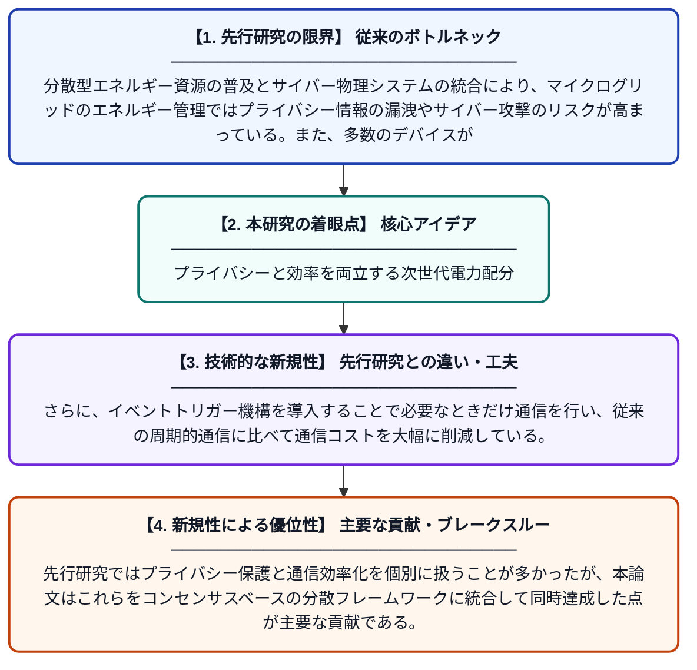

# イベントトリガー機構と改良型差分プライバシーを用いたマイクログリッドのコンセンサスベース分散型経済的負荷配分

**Original Title**: *Consensus-based distributed economic dispatch for microgrids with the event-triggered mechanism and improved differential privacy*

> **💡 一言要約**: プライバシーと効率を両立する次世代電力配分

| 項目 | 内容 |
|---|---|
| **著者** | Y Zha, P Li, Y Xu, F Wang |
| **掲載誌** | Global Energy Interconnection 2026 |
| **アラートキーワード** | differential privacy |
| **原文リンク** | [https://www.sciencedirect.com/science/article/pii/S2096511726000861](https://www.sciencedirect.com/science/article/pii/S2096511726000861) |
| **PDF版要約** | [README.pdf](./README.pdf) |

---

## 📊 新規性の図解（先行研究との違いと本研究のブレークスルー）

## 📝 要約

本論文は、マイクログリッドにおける分散型エネルギー資源の管理において、プライバシー漏洩・サイバー攻撃・通信制約という三大課題を同時に解決する手法を提案する。イベントトリガー機構と改良型差分プライバシーを組み合わせたコンセンサスベースの分散アルゴリズムを構築し、通信負荷を削減しながらプライバシーを保護しつつ最適な電力配分を実現する。提案手法はマイクログリッドの安全かつ効率的なエネルギー管理に向けた実用的なソリューションを提供する。

## ❓ どんな問題に取り組んだか

分散型エネルギー資源の普及とサイバー物理システムの統合により、マイクログリッドのエネルギー管理ではプライバシー情報の漏洩やサイバー攻撃のリスクが高まっている。また、多数のデバイスが頻繁に通信を行うことで通信帯域の逼迫も深刻な課題となっている。これらの問題を同時かつ効果的に解決する手法がこれまで十分に整備されていなかった。

## ✨ 何が新しい？何がすごい？（新規性）

本研究は、差分プライバシーを改良することでプライバシー保護の精度を高めつつ、アルゴリズムの収束性能を損なわないバランスを実現した点が独自性の核心である。さらに、イベントトリガー機構を導入することで必要なときだけ通信を行い、従来の周期的通信に比べて通信コストを大幅に削減している。先行研究ではプライバシー保護と通信効率化を個別に扱うことが多かったが、本論文はこれらをコンセンサスベースの分散フレームワークに統合して同時達成した点が主要な貢献である。

## 🎓 大学1年生向けの解説

マイクログリッドとは、太陽光発電や蓄電池などを組み合わせた小規模な電力ネットワークのことです。この電力網では、各発電装置がお互いに情報を共有しながら「どこがどれだけ電力を作るか」を協調して決める必要があります。しかし、情報を共有するとプライバシーが漏れたり、ハッカーに攻撃されたりする危険があります。この論文では、必要なときだけ通信する仕組みと、情報にわざとノイズを加えて個人情報を守る技術を組み合わせることで、安全かつ効率的に電力を配分できる方法を提案しています。
