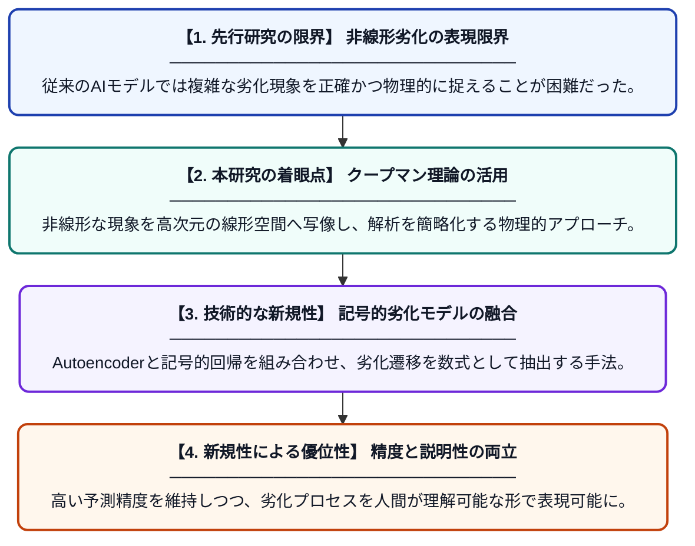

# Autoencoder-Koopaによる劣化表現学習と適応的記号時系列モデリングを用いた転がり軸受の寿命予測

**Original Title**: *Remaining useful life prediction of rolling bearings via Autoencoder-Koopa-based degradation representation learning and adaptive symbolic temporal modeling*

> **💡 一言要約**: AIと物理の融合で機械の寿命を数式として解明する

| 項目 | 内容 |
|---|---|
| **著者** | Y Zhou, W Zhang, JS Dhupia, X Zhang, Y Yan, Y Xu |
| **掲載誌** | Reliability Engineering & … 2026 |
| **アラートキーワード** | representation learning |
| **原文リンク** | [https://www.sciencedirect.com/science/article/pii/S095183202601553X](https://www.sciencedirect.com/science/article/pii/S095183202601553X) |
| **PDF版要約** | [README.pdf](./README.pdf) |

---

## 📊 新規性の図解（先行研究との違いと本研究のブレークスルー）

## 📝 要約

転がり軸受の余寿命（RUL）を正確に予測するため、Autoencoderとクープマン理論を融合させた新しい学習フレームワークを提案しています。劣化の過程を数学的に扱いやすい形式に変換し、記号的な時系列モデリングを組み合わせることで、高い予測精度と物理的な解釈性を両立させました。

## ❓ どんな問題に取り組んだか

従来の寿命予測手法では、機械の劣化に伴う複雑で非線形なダイナミクスを十分に捉えることが困難でした。また、多くのディープラーニング手法は内部プロセスが「ブラックボックス」であり、予測の根拠となる物理的な説明性が欠如しているという課題がありました。

## ✨ 何が新しい？何がすごい？（新規性）

非線形現象を線形空間で扱うクープマン理論をAutoencoderに組み込み、劣化特徴を効率的に抽出する「Autoencoder-Koopa」を開発しました。さらに、記号的モデリングを用いることで、劣化の遷移を具体的な数式として同定する手法を導入しています。これにより、先行研究と比較してノイズに強く、かつ予測プロセスを人間が数式で理解できる透明性を実現しました。

## 🎓 大学1年生向けの解説

機械の中で回転を支える「ベアリング」という部品が、あとどのくらいで壊れるかを当てるAIの研究です。これまではAIが「なんとなく」寿命を予測していましたが、この研究では数学のテクニックを使って、寿命までの道のりを「数式」で表せるようにしました。これにより、なぜその寿命になるのかが人間にも分かりやすくなり、より正確にメンテナンスの時期を決められるようになります。
