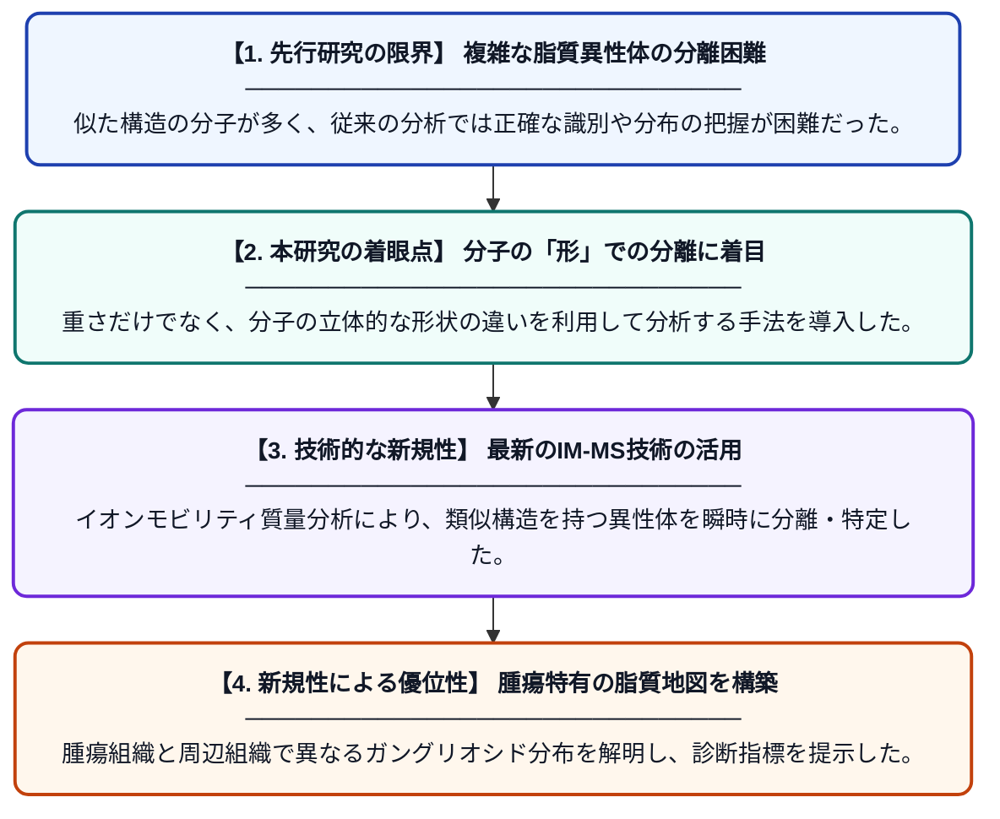

# イオンモビリティ質量分析法による乏突起膠腫および周辺組織のガングリオシドアトラスの構築

**Original Title**: *Ion Mobility Mass Spectrometry Enables the Generation of a Ganglioside Atlas in Oligodendroglioma and Matched Peritumoral Tissues*

> **💡 一言要約**: 脳腫瘍の脂質分布を精密に地図化

| 項目 | 内容 |
|---|---|
| **著者** | M Sarbu, D Fabris, M Jurilj Sajko, R Ica, MR Biricioiu… |
| **掲載誌** | Journal of the American Society for … |
| **アラートキーワード** | ICA |
| **原文リンク** | [https://pubs.acs.org/jamsef/article/doi/10.1021/jasms.6c00396/5461786](https://pubs.acs.org/jamsef/article/doi/10.1021/jasms.6c00396/5461786) |
| **PDF版要約** | [README.pdf](./README.pdf) |

---

## 📊 新規性の図解（先行研究との違いと本研究のブレークスルー）

## 📝 要約

イオンモビリティ質量分析法を用いて、脳腫瘍の一種である乏突起膠腫とその周辺組織におけるガングリオシドの多様性を網羅的に解析しました。腫瘍特有の分子パターンを特定し、これまで困難だった脂質異性体の分離に成功することで、詳細なガングリオシドアトラス（地図）を作成しました。

## ❓ どんな問題に取り組んだか

乏突起膠腫においてガングリオシドは腫瘍の進展に重要ですが、その構造が極めて複雑で多様なため、従来の分析法では異性体を正確に識別し、詳細な分布を把握することが困難でした。

## ✨ 何が新しい？何がすごい？（新規性）

本研究は、イオンモビリティ質量分析（IM-MS）を導入することで、従来の質量分析では区別できなかった類似構造のガングリオシドを分子の形状に基づいて精密に分離しました。これにより、乏突起膠腫の組織と正常な周辺組織における脂質の微細な違いを検出し、腫瘍に関連する特定のガングリオシド種を世界で初めて包括的にリスト化することに成功しました。

## 🎓 大学1年生向けの解説

脳の細胞の表面には、ガングリオシドという複雑な脂質（油の仲間）が並んでおり、細胞同士の連絡係をしています。この研究では、特殊な精密測定器を使って、脳腫瘍の細胞にあるガングリオシドの種類を一つずつ丁寧に調べ上げました。すると、腫瘍組織とそれ以外の組織で、脂質の形や種類に明確な違いがあることが分かり、それが「地図」のようにまとめられました。この成果は、将来的に脳腫瘍の新しい診断方法や治療薬の開発に役立つことが期待されています。
