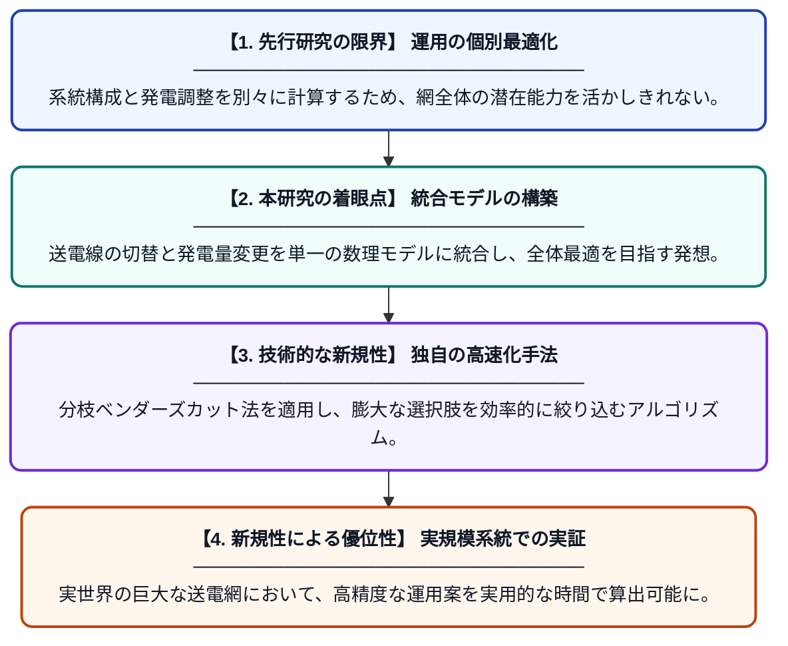

# 分枝ベンダーズカット法を用いた実世界の送電網におけるトポロジーと再配分の統合最適化

**Original Title**: *Integrated Topology and Redispatch Optimization of Real-World Power Transmission Systems using Branch-and-Benders-Cut*

> **💡 一言要約**: 送電ルートと発電量を同時に最適化する新技術

| 項目 | 内容 |
|---|---|
| **著者** | T Donkiewicz, O Gaul, M Lübbecke |
| **掲載誌** | arXiv preprint arXiv:2611.18302 2026 |
| **アラートキーワード** | optimization |
| **PDF** | [https://arxiv.org/pdf/2611.18302](https://arxiv.org/pdf/2611.18302) |
| **原文リンク** | [https://arxiv.org/pdf/2611.18302](https://arxiv.org/pdf/2611.18302) |
| **PDF版要約** | [README.pdf](./README.pdf) |

---

## 📊 新規性の図解（先行研究との違いと本研究のブレークスルー）

## 📝 要約

実世界の送電網において、送電線の接続切り替え（トポロジー）と発電機の出力調整（再配分）を同時に最適化する手法を提案しています。大規模な電力系統の運用効率を最大化するため、分枝ベンダーズカット法という高度なアルゴリズムを用いて実用的な計算時間を実現しました。

## ❓ どんな問題に取り組んだか

電力需要に応じた送電網の安定運用には、発電量の調整だけでなく送電線の切り替えが有効ですが、この両者を同時に最適化しようとすると計算量が爆発的に増えてしまいます。特に実規模の巨大な送電網では、従来の手法では現実的な時間内に最適な運用案を導き出すことが困難でした。

## ✨ 何が新しい？何がすごい？（新規性）

トポロジー変更と再配分を完全に統合した最適化モデルを構築し、実世界の複雑な運用制約を組み込んだ点が最大の特徴です。数学的に強力な「分枝ベンダーズカット法」を本問題に特化させて適用することで、従来手法では扱えなかった数千ノード規模の系統でも効率的に最適解を探索できるようにしました。これにより、送電コストの削減と系統の安全性を高い次元で両立させています。

## 🎓 大学1年生向けの解説

電気の通り道（送電網）は、実はスイッチ一つでルートを切り替えることができます。道が混んでいる時に「別の道を開く（トポロジー変更）」ことと「車の数を調整する（発電調整）」ことを同時に行えば、よりスムーズに電気を運べますが、その組み合わせは無限にあり計算が大変です。この研究は、その膨大な組み合わせの中からベストな答えを素早く見つけるための「賢い計算アルゴリズム」を開発しました。これにより、停電を防ぎつつ電気を効率よく安く届けることが可能になります。
