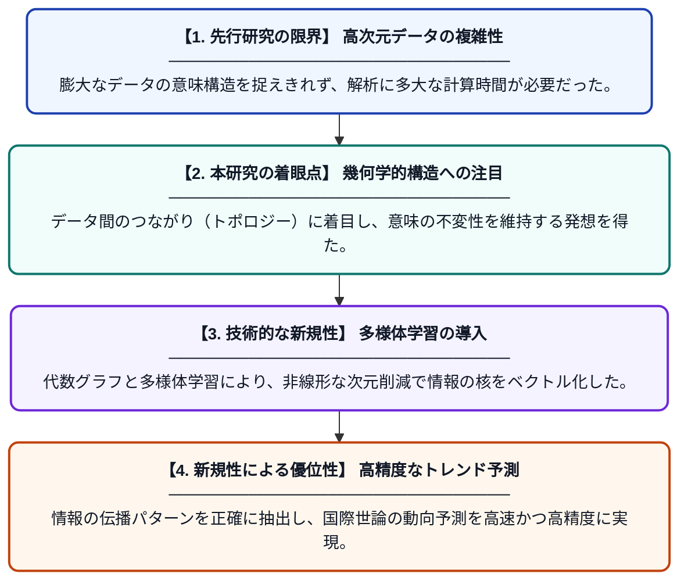

# グローバルネットワークにおける国際的な世論分析と伝播トレンド予測のためのビッグデータマイニングモデル

**Original Title**: *Big data mining model for international public opinion analysis and communication trend prediction across global networks*

> **💡 一言要約**: グラフ理論で世界中の世論とトレンドを読み解く

| 項目 | 内容 |
|---|---|
| **著者** | Y Ma, E yan tuo Ma |
| **掲載誌** | … Conference on Wireless, Optical Communication, and … 2026 |
| **アラートキーワード** | manifold learning |
| **原文リンク** | [https://www.spiedigitallibrary.org/conference-proceedings-of-spie/14497/144973M/Big-data-mining-model-for-international-public-opinion-analysis-and/10.1117/12.3136614.short](https://www.spiedigitallibrary.org/conference-proceedings-of-spie/14497/144973M/Big-data-mining-model-for-international-public-opinion-analysis-and/10.1117/12.3136614.short) |
| **PDF版要約** | [README.pdf](./README.pdf) |

---

## 📊 新規性の図解（先行研究との違いと本研究のブレークスルー）

## 📝 要約

代数グラフ理論と多様体学習を融合させた新しいテキストベクトル化フレームワークを提案し、国際的な世論の動向を分析するモデルを構築しました。非線形次元削減を用いることで、データの幾何学的構造を維持したまま計算効率の高い低次元ベクトルを生成し、複雑な情報の伝播トレンドを正確に予測します。

## ❓ どんな問題に取り組んだか

多言語かつ膨大なデータが流通する国際社会において、従来のテキスト解析手法では情報の複雑な関係性や意味の変遷を十分に捉えきれませんでした。また、高次元データの処理に伴う膨大な計算コストが、リアルタイムな世論予測の大きな障害となっていました。

## ✨ 何が新しい？何がすごい？（新規性）

本研究の新規性は、代数グラフ理論と多様体学習を組み合わせ、データの「トポロジー（接続構造）」を維持したまま次元を削減する手法を確立した点にあります。先行研究が苦手としていた単語間の非線形な関係性を保持しつつ、情報の不変性を備えた低次元ベクトルを生成できる点が大きな強みです。これにより、国際的な情報の流れをより本質的に理解し、高精度なトレンド予測を可能にしました。

## 🎓 大学1年生向けの解説

世界中で毎日発信される膨大なニュースやSNSの投稿から、世論がどう動いているかを知ることは非常に重要です。この研究は、数学の知恵を使って、言葉同士の複雑なつながりを整理されたシンプルな図に変換する新しい方法を開発しました。これまでは難しかった「情報の意味」を正確に保ったままデータを小さく整理できるため、次にどのような話題が世界で注目されるかを素早く、正しく予測できるようになります。
