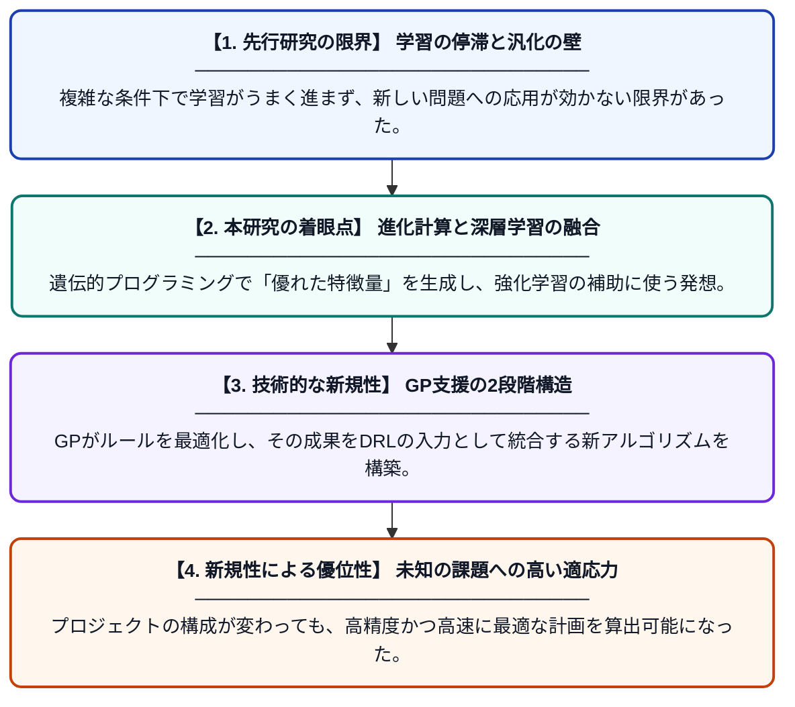

# リソース制約付きプロジェクトスケジューリング問題のための遺伝的プログラミング支援型2段階深層強化学習フレームワーク

**Original Title**: *A Two-stage Genetic-programming-assisted Deep Reinforcement Learning Framework for Resource Constrained Project Scheduling Problem*

> **💡 一言要約**: AIが「解き方のコツ」を自作して最適化する工程管理

| 項目 | 内容 |
|---|---|
| **著者** | L Li, H Chen, J Zhang |
| **掲載誌** | Applied Soft Computing 2026 |
| **アラートキーワード** | rcpsp |
| **原文リンク** | [https://www.sciencedirect.com/science/article/pii/S1568494626023495](https://www.sciencedirect.com/science/article/pii/S1568494626023495) |
| **PDF版要約** | [README.pdf](./README.pdf) |

---

## 📊 新規性の図解（先行研究との違いと本研究のブレークスルー）

## 📝 要約

リソース制約付きプロジェクトスケジューリング問題（RCPSP）を解くため、遺伝的プログラミング（GP）と深層強化学習（DRL）を統合した2段階フレームワークを提案しています。GPによって生成されたヒューリスティックなルールをDRLの学習に活用することで、従来手法では困難だった複雑な状態での学習効率と汎化性能を大幅に向上させました。

## ❓ どんな問題に取り組んだか

従来の深層強化学習（DRL）を用いた手法では、プロジェクトの複雑な状態を適切に学習できず、効率が低下するという課題がありました。また、プロジェクトの規模やリソース条件が変化した際に、学習済みモデルがうまく対応できない「汎化性能の不足」も大きな問題となっていました。

## ✨ 何が新しい？何がすごい？（新規性）

本研究の最大の特徴は、遺伝的プログラミング（GP）を用いて「学習を支援する特徴量や優先ルール」を自動的に進化・生成させ、それをDRLに組み込む2段階構造を採用した点にあります。固定された特徴量を用いる従来手法とは異なり、問題の構造に合わせて最適な表現を自律的に獲得できるため、未知のデータに対しても高い精度を発揮します。これにより、スケジューリングの精度向上と計算コストの削減を同時に達成しました。

## 🎓 大学1年生向けの解説

限られた人数や道具を使って、たくさんの作業を最短で終わらせる計画を立てることは「非常に難しいパズル」のようなものです。この研究では、AIにいきなり問題を解かせるのではなく、まず「パズルの解き方のコツ」をAI自身に考えさせ、そのコツを使って本番の問題に挑ませるという2段構えの作戦をとりました。この工夫によって、今までAIが苦手だった複雑なパズルも、より速く正確に解けるようになりました。
