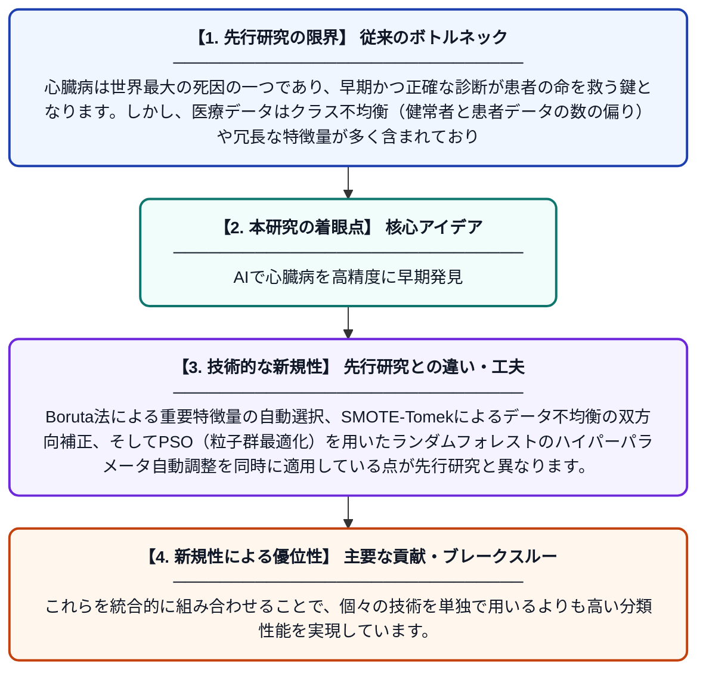

# BorutaFeature選択とSMOTE-Tomekデータバランシング技術を用いたPSO-ランダムフォレストによる心臓病分類の実装

**Original Title**: *Implementation of PSO-Random Forest in Classification of Heart Disease with Boruta Feature Selection and Data Balancing Technique SMOTE-Tomek*

> **💡 一言要約**: AIで心臓病を高精度に早期発見

| 項目 | 内容 |
|---|---|
| **著者** | FW Habibi |
| **掲載誌** | 2026 |
| **アラートキーワード** | SMOTE |
| **原文リンク** | [https://repository.upnjatim.ac.id/57221/](https://repository.upnjatim.ac.id/57221/) |
| **PDF版要約** | [README.pdf](./README.pdf) |

---

## 📊 新規性の図解（先行研究との違いと本研究のブレークスルー）

## 📝 要約

本研究は、世界で年間1700万人の死者を出す心臓病の早期発見精度向上を目的としています。Boruta特徴選択とSMOTE-Tomekによるデータ不均衡補正を組み合わせたPSO最適化ランダムフォレストを提案しています。これにより、従来手法と比較して心臓病分類の精度を大幅に改善することを目指しています。

## ❓ どんな問題に取り組んだか

心臓病は世界最大の死因の一つであり、早期かつ正確な診断が患者の命を救う鍵となります。しかし、医療データはクラス不均衡（健常者と患者データの数の偏り）や冗長な特徴量が多く含まれており、従来の機械学習モデルでは分類精度が低下するという問題がありました。

## ✨ 何が新しい？何がすごい？（新規性）

本研究の新規性は、複数の高度な技術を組み合わせた統合フレームワークにあります。Boruta法による重要特徴量の自動選択、SMOTE-Tomekによるデータ不均衡の双方向補正、そしてPSO（粒子群最適化）を用いたランダムフォレストのハイパーパラメータ自動調整を同時に適用している点が先行研究と異なります。これらを統合的に組み合わせることで、個々の技術を単独で用いるよりも高い分類性能を実現しています。

## 🎓 大学1年生向けの解説

心臓病は早く見つけるほど助かる可能性が高まりますが、医師だけでは全員を診断するのは大変です。そこでこの研究では、コンピュータに心臓病かどうかを自動で判断させる仕組みを作りました。データのばらつきを補正し、重要な情報だけを選び出し、さらにAIの設定を自動で最適化することで、より正確な診断を可能にしています。例えるなら、良い食材を選び（特徴選択）、レシピを最適化し（PSO）、バランスよく調理する（データ補正）ようなイメージです。
