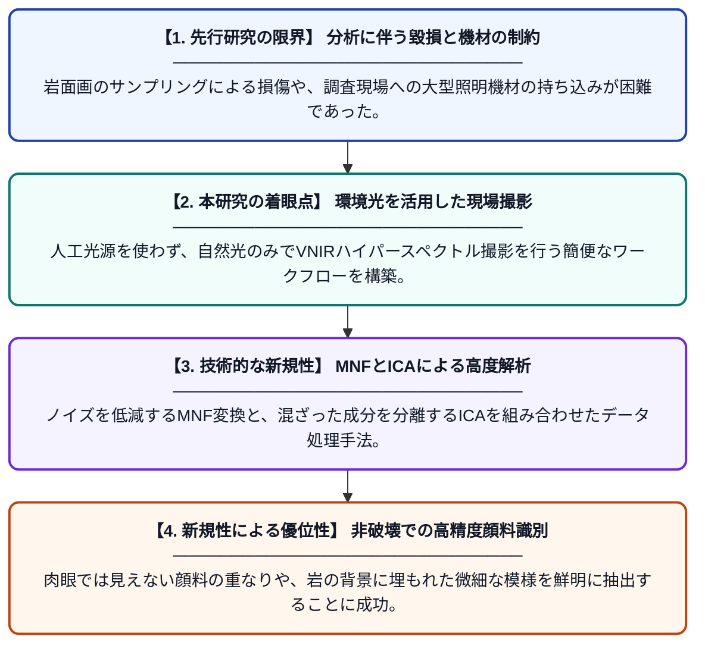

# マルト族の岩面画における顔料分析のための環境光VNIRハイパースペクトルイメージング

**Original Title**: *Ambient light VNIR hyperspectral imaging for pigment analysis in Martu rock art*

> **💡 一言要約**: 自然光とAI解析で岩面画の「色」を解き明かす

| 項目 | 内容 |
|---|---|
| **著者** | A Papasergio, S Mutch, KM Thompson, G Marini… |
| **掲載誌** | npj Heritage Science 2026 |
| **アラートキーワード** | independent component ... |
| **PDF** | [https://www.nature.com/articles/s40494-026-03089-z_reference.pdf](https://www.nature.com/articles/s40494-026-03089-z_reference.pdf) |
| **原文リンク** | [https://www.nature.com/articles/s40494-026-03089-z_reference.pdf](https://www.nature.com/articles/s40494-026-03089-z_reference.pdf) |
| **PDF版要約** | [README.pdf](./README.pdf) |

---

## 📊 新規性の図解（先行研究との違いと本研究のブレークスルー）

## 📝 要約

オーストラリアのマルト族の岩面画を対象に、自然光（環境光）を用いた可視・近赤外（VNIR）ハイパースペクトル撮影による非破壊的な顔料分析手法を提案した。MNF変換と独立成分分析（ICA）を組み合わせることで、複雑な地質背景から顔料情報を高精度に分離・抽出することに成功している。

## ❓ どんな問題に取り組んだか

岩面画の分析において、物理的なサンプル採取は文化遺産の毀損につながるため厳しく制限される。また、従来のハイパースペクトル撮影は強力な人工光源を必要とすることが多く、遠隔地の過酷な環境にある遺跡での実施は技術的・物流的に困難であった。

## ✨ 何が新しい？何がすごい？（新規性）

人工照明を使用せず、変動しやすい環境光下での撮影データから高精度な情報を抽出するプロセスを確立した点が画期的である。MNFでノイズを抑えつつ、ICAによって重なり合った顔料や背景の岩石成分を独立した画像として分離することで、肉眼では判別不能な微細な顔料の分布を可視化し、先行研究よりも簡便かつ詳細な分析を可能にした。

## 🎓 大学1年生向けの解説

大昔の岩壁に描かれた絵を、壊したり触れたりせずに詳しく調べる技術についての研究です。特別なカメラで「光の波長」を細かく分けることで、使われている絵の具の種類を特定します。これまでは夜間に大きなライトを当てて撮影する必要がありましたが、この方法なら太陽の光だけで、重なって描かれた絵や消えかかった模様もはっきりと見つけ出すことができます。
