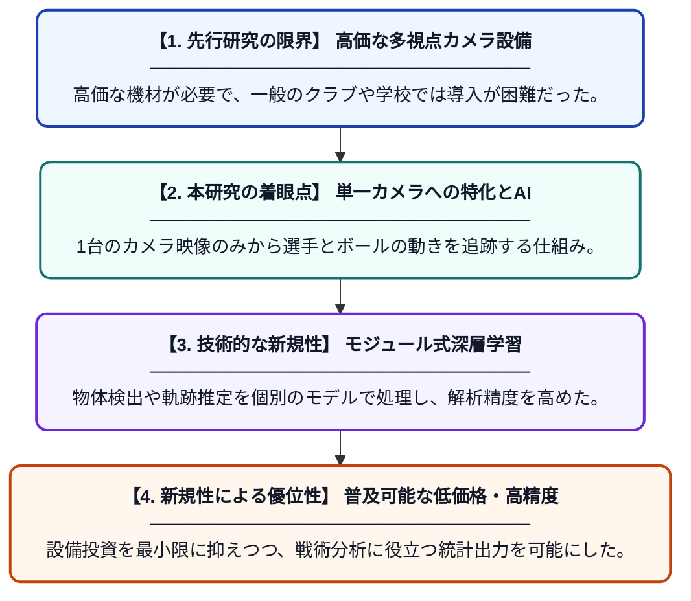

# SquashSight：単一カメラと深層学習によるスカッシュ試合の自動解析とコーチング支援パイプライン

**Original Title**: *SquashSight: A Single-Camera Deep Learning Pipeline for Automated Squash Match Analysis and Coaching Decision Support*

> **💡 一言要約**: 1台のカメラでスカッシュをプロ級に自動解析！

| 項目 | 内容 |
|---|---|
| **著者** | Y Elhajj, M ElGhobary, N Safwat, N Kasaby… |
| **掲載誌** | Big Data and Cognitive … 2026 |
| **アラートキーワード** | Multi Camera Tracking |
| **原文リンク** | [https://www.mdpi.com/2504-2289/10/11/369](https://www.mdpi.com/2504-2289/10/11/369) |
| **PDF版要約** | [README.pdf](./README.pdf) |

---

## 📊 新規性の図解（先行研究との違いと本研究のブレークスルー）

## 📝 要約

高価な複数カメラ設備を必要とせず、市販のカメラ1台の映像からスカッシュの試合を自動解析する深層学習システム「SquashSight」を提案しています。選手の動きやボールの軌跡を追跡し、コーチングに役立つ統計データや意思決定支援を低コストで提供します。

## ❓ どんな問題に取り組んだか

従来のプロ仕様のスカッシュ解析システムは、複数の高価なカメラ設置が必要であり、一般のクラブやアカデミーにはコスト面で手が届きませんでした。また、人手によるデータ収集は時間がかかり、即時性のあるフィードバックが困難という課題がありました。

## ✨ 何が新しい？何がすごい？（新規性）

モジュール式の深層学習パイプラインを採用し、単一の固定カメラ映像のみから選手とボールの動きを正確に追跡・抽出する手法を確立しました。従来の多視点カメラシステムに匹敵する解析精度を維持しながら、導入コストを劇的に下げた点が最大の貢献です。自動化されたイベント検出により、戦術的な意思決定を支援する詳細な統計を即座に生成可能です。

## 🎓 大学1年生向けの解説

スカッシュの試合を分析するには、これまでは壁中に高価なカメラを何台も取り付ける必要がありました。この研究では、普通のカメラ1台の映像をAI（深層学習）に読み込ませるだけで、選手やボールがどこにいるかを自動で把握する技術を開発しました。これにより、お金をかけなくてもプロのようなデータ分析が誰でもできるようになります。部活動やスクールでの練習をより科学的に効率化できる画期的な仕組みです。
